# 🔭 Monitoring, Logging and Observability for DevOps

A complete A to Z lesson that takes you from **DevOps intern to confident engineer** in monitoring, logging and observability. It covers **Prometheus, Grafana, Alertmanager, Datadog, New Relic, Zabbix, Nagios, ELK/EFK, Fluent Bit, Loki, Splunk, Jaeger, Zipkin, Tempo and OpenTelemetry**, with diagrams, real config files, and a lab you can run on your laptop.

Every topic follows the same pattern: **What it is** → **Why DevOps people care** → **Try it now**. Read in order, type every command yourself, and finish with the labs in Part 5.

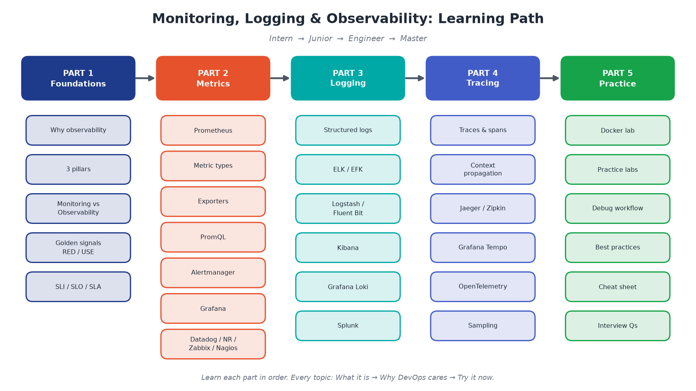

> 💡 **Tip:** Start the lab early (see [Section 36](#36-hands-on-lab-run-the-full-stack)). Having Prometheus, Grafana, Loki and Jaeger running while you read makes every section 10x easier to understand.

---

## 📚 Table of Contents

**PART 1: Foundations (Why We Watch Systems)**

1. [Start Here: Why Observability Matters](#1-start-here-why-observability-matters)
2. [The Three Pillars: Metrics, Logs, Traces](#2-the-three-pillars-metrics-logs-traces)
3. [Monitoring vs Observability](#3-monitoring-vs-observability)
4. [SLI, SLO, SLA and Error Budgets](#4-sli-slo-sla-and-error-budgets)

**PART 2: Monitoring and Metrics**

5. [Prometheus: The Metrics Engine](#5-prometheus-the-metrics-engine)
6. [Pull vs Push Model](#6-pull-vs-push-model)
7. [Metric Types](#7-metric-types)
8. [Instrumenting Your Application](#8-instrumenting-your-application)
9. [Exporters](#9-exporters)
10. [Configuring Prometheus](#10-configuring-prometheus)
11. [PromQL Basics](#11-promql-basics)
12. [PromQL in Practice](#12-promql-in-practice)
13. [Alerting Rules](#13-alerting-rules)
14. [Alertmanager](#14-alertmanager)
15. [Grafana: Dashboards](#15-grafana-dashboards)
16. [Dashboard Design](#16-dashboard-design)
17. [Grafana Alerting](#17-grafana-alerting)
18. [Other Monitoring Tools: Datadog, New Relic, Zabbix, Nagios](#18-other-monitoring-tools-datadog-new-relic-zabbix-nagios)

**PART 3: Logging**

19. [Logging Fundamentals](#19-logging-fundamentals)
20. [The Log Pipeline](#20-the-log-pipeline)
21. [ELK vs EFK Stack](#21-elk-vs-efk-stack)
22. [Elasticsearch](#22-elasticsearch)
23. [Logstash](#23-logstash)
24. [Fluentd and Fluent Bit](#24-fluentd-and-fluent-bit)
25. [Kibana](#25-kibana)
26. [Grafana Loki](#26-grafana-loki)
27. [Splunk](#27-splunk)
28. [Choosing a Logging Stack](#28-choosing-a-logging-stack)

**PART 4: Tracing and Observability**

29. [Distributed Tracing Concepts](#29-distributed-tracing-concepts)
30. [Context Propagation](#30-context-propagation)
31. [Jaeger](#31-jaeger)
32. [Zipkin and Grafana Tempo](#32-zipkin-and-grafana-tempo)
33. [OpenTelemetry (OTel)](#33-opentelemetry-otel)
34. [Sampling](#34-sampling)
35. [Correlating the Pillars](#35-correlating-the-pillars)

**PART 5: Practice**

36. [Hands-on Lab: Run the Full Stack](#36-hands-on-lab-run-the-full-stack)
37. [Practice Labs](#37-practice-labs)
38. [Debugging Workflow: Using All Three Pillars](#38-debugging-workflow-using-all-three-pillars)
39. [Best Practices and Anti-Patterns](#39-best-practices-and-anti-patterns)
40. [Cheat Sheet](#40-cheat-sheet)
41. [Interview Questions](#41-interview-questions)
42. [Reference](#42-reference)

---

# PART 1: Foundations (Why We Watch Systems)

## 1. Start Here: Why Observability Matters

**What it is:** Monitoring, logging and observability are how you **see inside running systems**. Your app is a black box once it is deployed. These tools turn it into a glass box.

**Why DevOps people care:** "You build it, you run it." In DevOps, the team that ships code is also responsible when it breaks at 3 a.m. Without good telemetry you are guessing. With it, you can:

- Find out something is broken **before customers tell you**
- Find **where** and **why** in minutes instead of hours
- Prove a deployment made things **better or worse**
- Plan capacity (when will the disk fill? do we need more pods?)
- Measure reliability with **SLOs** and make data-driven decisions

A simple story you will see again and again:

```text
09:00  Deploy v2.3 of checkout-api
09:07  ALERT: HighErrorRate on /api/orders (8%)            <- METRICS told us WHAT
09:09  Open trace of a failed request: payment span red     <- TRACES told us WHERE
09:10  Logs for that trace_id: "card provider timeout 2s"   <- LOGS told us WHY
09:12  Roll back to v2.2, errors drop to 0.1%
09:30  Postmortem: v2.3 lowered the HTTP client timeout
```

### 1.1 What you will be able to do after this guide

| Skill | Section |
|-------|---------|
| Explain metrics vs logs vs traces in an interview | 2, 3 |
| Define SLIs, SLOs and error budgets | 4 |
| Install Prometheus, add targets, write PromQL | 5 to 12 |
| Write alert rules and route them with Alertmanager | 13, 14 |
| Build Grafana dashboards and alerts | 15 to 17 |
| Compare Datadog, New Relic, Zabbix, Nagios | 18 |
| Build a log pipeline with ELK / EFK / Fluent Bit | 19 to 25 |
| Query logs with LogQL (Loki) and SPL (Splunk) | 26, 27 |
| Explain distributed tracing and context propagation | 29, 30 |
| Run Jaeger and instrument an app with OpenTelemetry | 31 to 34 |
| Debug an incident using all three pillars | 35, 38 |

### 1.2 The 15 words you will see everywhere

| Word | Plain meaning |
|------|---------------|
| **Telemetry** | Data a system emits about itself (metrics, logs, traces, events) |
| **Metric** | A number measured over time, e.g. `cpu_usage = 73%` every 15s |
| **Log** | A timestamped text/JSON record of something that happened |
| **Trace** | The full journey of one request through many services |
| **Span** | One step inside a trace (e.g. "DB query took 40ms") |
| **Label / Tag** | Key-value pair that describes data, e.g. `env="prod"` |
| **Cardinality** | Number of unique label combinations. High cardinality = expensive |
| **Scrape** | Prometheus pulling metrics from a target over HTTP |
| **Exporter** | A helper that converts a system's stats into Prometheus format |
| **Instrumentation** | Code (or an agent) that makes your app emit telemetry |
| **Alert** | A rule that notifies a human when a condition is true |
| **Dashboard** | A page of charts that shows system health |
| **SLI / SLO / SLA** | Indicator / Objective / Agreement for reliability |
| **MTTD / MTTR** | Mean Time To Detect / Mean Time To Recover (or Resolve) |
| **On-call** | The person who responds to alerts during a shift |

---

## 2. The Three Pillars: Metrics, Logs, Traces

**What it is:** Observability data comes in three main types, called the **three pillars**. Each one answers a different question.

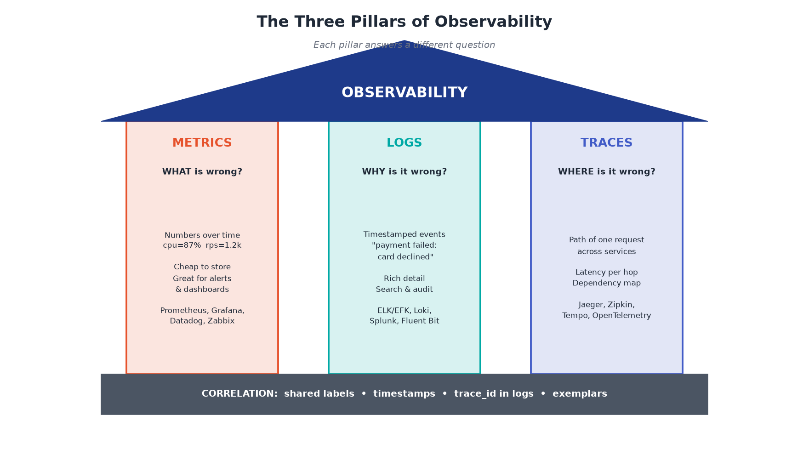

| | Metrics | Logs | Traces |
|---|---|---|---|
| **Answers** | WHAT is wrong? | WHY is it wrong? | WHERE is it wrong? |
| **Shape** | number + labels + timestamp | timestamp + message/fields | tree of spans with timings |
| **Example** | `http_requests_total{status="500"} 42` | `{"level":"error","msg":"db timeout"}` | `checkout → cart → db (95ms)` |
| **Cost to store** | 💚 Low | 🟠 High (volume) | 🟡 Medium (usually sampled) |
| **Best for** | Alerts, dashboards, trends | Debugging details, audit | Latency, dependencies, microservices |
| **Tools** | Prometheus, Datadog, Zabbix | ELK, Loki, Splunk | Jaeger, Zipkin, Tempo |

The real power comes from **linking them together** (Section 35): a spike on a dashboard → an example trace → the logs for that exact trace.

> 💡 **Tip:** Some people add a 4th pillar: **events** (deploys, config changes) and a 5th: **profiles** (continuous CPU/memory profiling with tools like Pyroscope). Start with the main three.

### 2.1 Try it now

Look at what each pillar looks like in raw form:

```text
# METRIC (Prometheus text format)
http_requests_total{method="GET",route="/api/orders",status="200"} 1027
http_requests_total{method="GET",route="/api/orders",status="502"} 113

# LOG (structured JSON)
{"ts":"2026-11-20T10:01:07","level":"error","msg":"payment failed","trace_id":"4bf92f35..."}

# TRACE (simplified)
trace 4bf92f35...
 └─ GET /api/orders           310ms
     ├─ db.query               45ms
     └─ payment.charge        240ms  ERROR
```

---

## 3. Monitoring vs Observability

**What it is:**

- **Monitoring** = watching **known** failure modes with predefined checks ("Is CPU above 90%?").
- **Observability** = how well you can understand **any** internal state from the outside, including problems you never predicted.

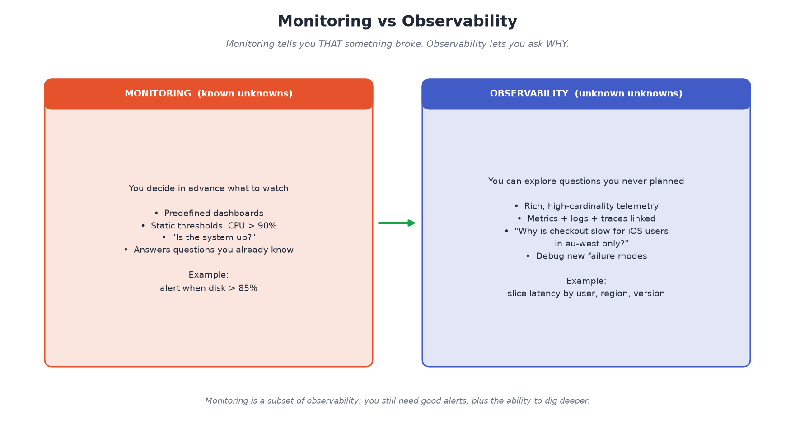

**Why DevOps people care:** In a monolith on 3 servers, monitoring was enough. In 200 microservices on Kubernetes, new kinds of failure appear every week. You can't write an alert for every possible problem, so you need data rich enough to ask new questions.

| Monitoring | Observability |
|------------|---------------|
| Known unknowns | Unknown unknowns |
| "Is it broken?" | "Why is it broken, and for whom?" |
| Dashboards + thresholds | Explore, slice, correlate |
| Reactive | Proactive + investigative |
| Necessary | Builds on top of monitoring |

### 3.1 What should I measure? Golden Signals, RED and USE

Beginners often ask "which metrics matter?" Use these three proven methods:

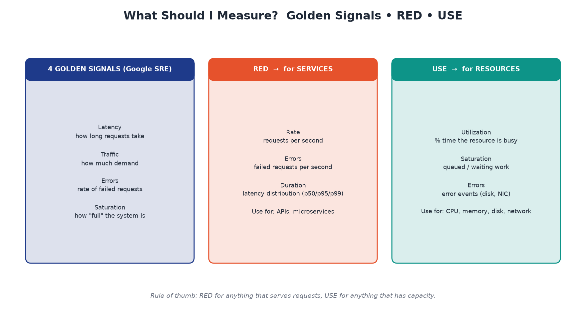

| Method | For | Signals | Example PromQL |
|--------|-----|---------|----------------|
| **4 Golden Signals** | Any user-facing system | Latency, Traffic, Errors, Saturation | see below |
| **RED** | Services / APIs | **R**ate, **E**rrors, **D**uration | `sum(rate(http_requests_total[5m]))` |
| **USE** | Resources (CPU, disk, NIC) | **U**tilization, **S**aturation, **E**rrors | `node_load1`, `node_cpu_seconds_total` |

> 💡 **Tip:** If you only remember one thing: **RED for every service, USE for every machine.**

### 3.2 Black-box vs white-box monitoring

| Type | How | Example |
|------|-----|---------|
| **Black-box** | Test from the outside like a user | Ping a URL every 30s (blackbox_exporter, uptime checks) |
| **White-box** | Use data from inside the system | App metrics, logs, traces |

You need both: black-box tells you users are affected, white-box tells you why.

---

## 4. SLI, SLO, SLA and Error Budgets

**What it is:** A shared language for "how reliable is reliable enough?"

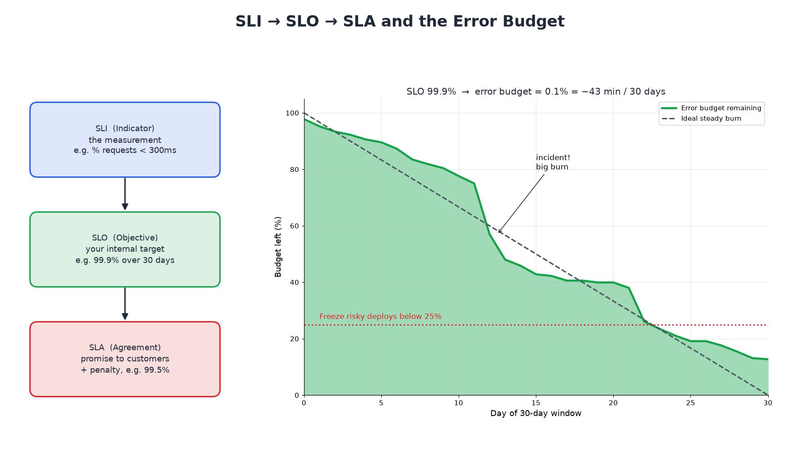

| Term | Meaning | Example |
|------|---------|---------|
| **SLI** (Indicator) | A measurement of user happiness | % of requests that succeed in < 300ms |
| **SLO** (Objective) | Internal target for the SLI | 99.9% over 30 days |
| **SLA** (Agreement) | Contract with customers, with penalties | 99.5% or we refund 10% |
| **Error budget** | `100% − SLO` = allowed unreliability | 0.1% = ~43 minutes/month |

**Why DevOps people care:** The error budget turns arguments into math. Budget left? Ship features fast. Budget burned? Freeze risky deploys and fix reliability.

### 4.1 Allowed downtime cheat table

| SLO | Downtime per 30 days | Per year |
|-----|---------------------|----------|
| 99% | 7h 12m | 3.65 days |
| 99.5% | 3h 36m | 1.83 days |
| 99.9% | 43m 12s | 8h 46m |
| 99.95% | 21m 36s | 4h 23m |
| 99.99% | 4m 19s | 52m 36s |

### 4.2 Try it now: an availability SLI in PromQL

```promql
# Availability SLI = good requests / all requests (last 30 days)
sum(rate(http_requests_total{status!~"5.."}[30d]))
/
sum(rate(http_requests_total[30d]))
```

> ⚠ **Warning:** Never set an SLO of 100%. It is impossible, and it leaves zero budget for deploys, maintenance or experiments.

---

# PART 2: Monitoring and Metrics

## 5. Prometheus: The Metrics Engine

**What it is:** Prometheus is an open-source monitoring system and **time-series database** (TSDB). It **pulls** (scrapes) metrics from targets over HTTP, stores them, lets you query them with **PromQL**, and evaluates **alert rules**. It is a CNCF graduated project (the second after Kubernetes) and is the default for cloud-native monitoring.

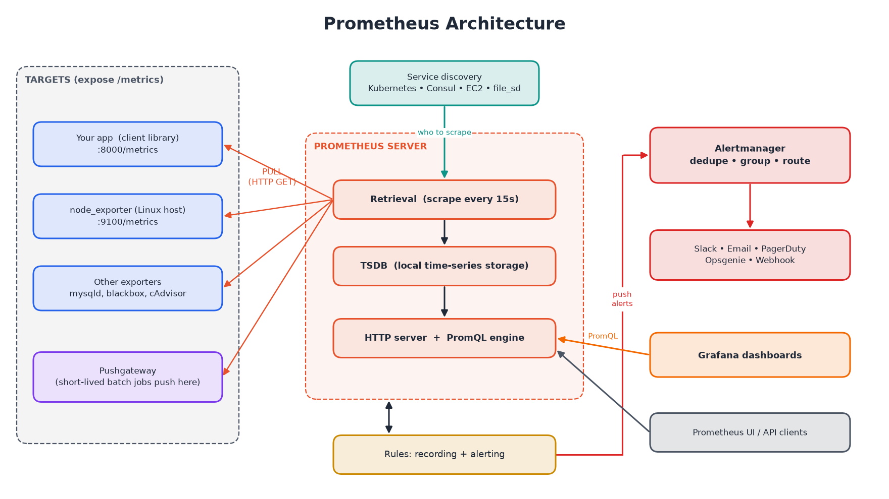

| Component | Job |
|-----------|-----|
| **Prometheus server** | Scrapes targets, stores time series, runs PromQL and rules |
| **Targets / exporters** | Expose metrics at `/metrics` in text format |
| **Service discovery** | Finds targets automatically (Kubernetes, Consul, EC2, files) |
| **Pushgateway** | Holds metrics pushed by short-lived batch jobs |
| **Alertmanager** | Receives alerts and sends notifications (Section 14) |
| **Grafana** | Dashboards on top of Prometheus (Section 15) |

**Why DevOps people care:** Prometheus is in almost every Kubernetes job description. kube-prometheus-stack is the most common way to monitor clusters.

### 5.1 The data model

Every time series is identified by a **metric name + labels**:

```text
http_requests_total{method="POST", route="/api/orders", status="201"}  1027 @1732096800
└──── metric name ─┘└──────────────── labels ──────────────────────┘  value  timestamp
```

> ⚠ **Warning:** Every unique label combination is a new time series. A label like `user_id` with 1 million users creates 1 million series and can crash Prometheus. This is the **cardinality** problem. Never put IDs, emails, or full URLs in labels.

### 5.2 Try it now: install Prometheus

```bash
# Option A: Docker (fastest)
docker run -d --name prometheus -p 9090:9090 prom/prometheus:v3.0.1
# open http://localhost:9090  →  Status → Targets

# Option B: Linux binary
wget https://github.com/prometheus/prometheus/releases/download/v3.0.1/prometheus-3.0.1.linux-amd64.tar.gz
tar xzf prometheus-3.0.1.linux-amd64.tar.gz
cd prometheus-3.0.1.linux-amd64
./prometheus --config.file=prometheus.yml
```

Then run your first query in the UI: `up`. A value of `1` means the target is reachable; `0` means it is down.

---

## 6. Pull vs Push Model

**What it is:** Two ways for metrics to travel from a system to the monitoring backend.

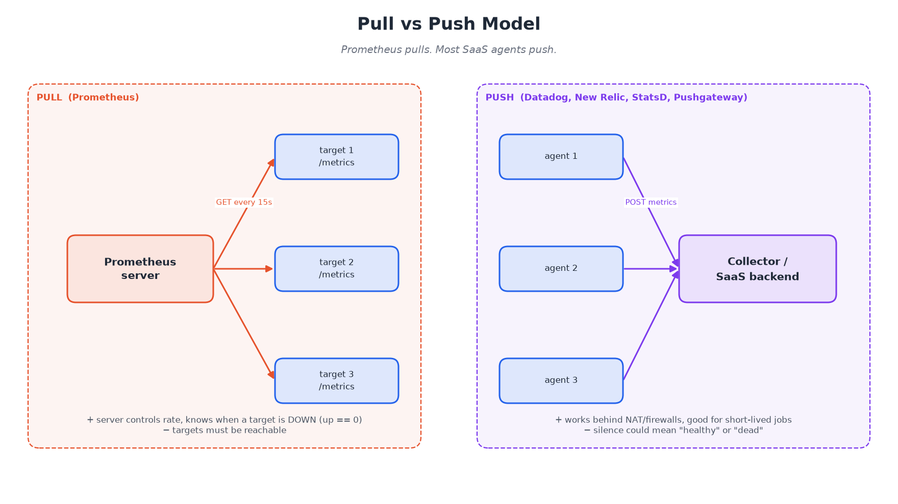

| | Pull (Prometheus) | Push (Datadog agent, StatsD, Pushgateway, OTLP) |
|---|---|---|
| Who starts the connection | Monitoring server | The app/agent |
| Detect a dead target | ✅ Easy: `up == 0` | ❌ Silence is ambiguous |
| Works behind NAT/firewall | ❌ Needs network access to targets | ✅ Yes |
| Short-lived jobs | ❌ May finish before scrape | ✅ Yes |
| Control load on server | ✅ Server decides scrape rate | ❌ Clients can flood |

> 💡 **Tip:** For a cron job that runs for 10 seconds, push its result to the **Pushgateway**, and Prometheus will scrape the Pushgateway. Do not use Pushgateway for long-running services.

---

## 7. Metric Types

**What it is:** Prometheus has four metric types. Choosing the right one is the most important instrumentation decision.

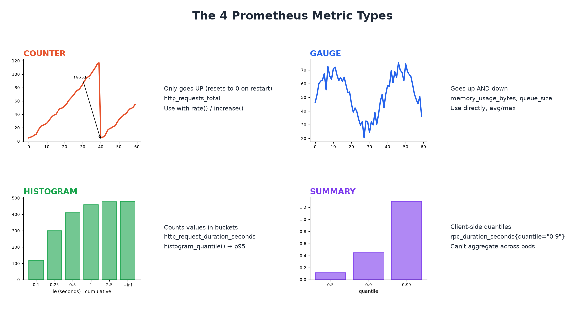

| Type | Behaviour | Example | How to query |
|------|-----------|---------|--------------|
| **Counter** | Only increases (resets to 0 on restart) | `http_requests_total`, `errors_total` | `rate()`, `increase()` |
| **Gauge** | Goes up and down | `memory_usage_bytes`, `queue_length`, `temperature` | use directly, `avg_over_time()` |
| **Histogram** | Counts observations in buckets (+ `_sum`, `_count`) | `http_request_duration_seconds` | `histogram_quantile()` |
| **Summary** | Calculates quantiles in the client | `rpc_duration_seconds{quantile="0.99"}` | read directly, can't aggregate |

A histogram creates several series:

```text
http_request_duration_seconds_bucket{le="0.1"}   120   # requests ≤ 0.1s
http_request_duration_seconds_bucket{le="0.25"}  300   # requests ≤ 0.25s (cumulative)
http_request_duration_seconds_bucket{le="+Inf"}  480   # all requests
http_request_duration_seconds_sum                 96.3  # total seconds
http_request_duration_seconds_count               480   # total requests
```

> 💡 **Tip:** Prefer **histograms over summaries**. You can aggregate histograms across 50 pods and calculate p95 for the whole service. Averaging summaries' percentiles is mathematically wrong.

---

## 8. Instrumenting Your Application

**What it is:** Adding code (a **client library**) to your app so it exposes its own metrics at `/metrics`.

**Why DevOps people care:** Exporters can tell you the CPU is at 90%. Only the app can tell you "orders are failing because of PayPal."

### 8.1 Try it now: Python example

```python
from prometheus_client import Counter, Histogram, start_http_server
import random, time

REQUESTS = Counter("http_requests_total", "Total requests", ["route", "status"])
LATENCY  = Histogram("http_request_duration_seconds", "Latency", ["route"])

start_http_server(8000)          # serves http://localhost:8000/metrics
while True:
    with LATENCY.labels("/api/orders").time():
        time.sleep(random.uniform(0.05, 0.3))
    REQUESTS.labels("/api/orders", random.choice(["200", "200", "500"])).inc()
```

```bash
pip install prometheus-client
python app.py
curl localhost:8000/metrics | grep http_requests_total
```

The full instrumented app (metrics + logs + traces) is in [`examples/observability-stack/sample-app/app.py`](examples/observability-stack/sample-app/app.py).

Client libraries exist for **Go, Java, Python, Node.js, .NET, Ruby, Rust** and more. Spring Boot exposes metrics via **Micrometer** at `/actuator/prometheus`.

### 8.2 Naming and label best practices

| ✅ Do | ❌ Don't |
|------|---------|
| `http_requests_total` (snake_case, `_total` for counters) | `HttpRequests`, `requests-count` |
| Base units: `_seconds`, `_bytes` | `_milliseconds`, `_mb` |
| Labels with few values: `method`, `status`, `route` | Labels like `user_id`, `email`, `/orders/12345` |
| Use the route template `/orders/{id}` | Use the raw path `/orders/12345` |
| One metric with a `status` label | `http_200_total`, `http_500_total` |

---

## 9. Exporters

**What it is:** An exporter is a small program that reads stats from a system that doesn't speak Prometheus (Linux, MySQL, Redis, a URL) and exposes them at `/metrics`.

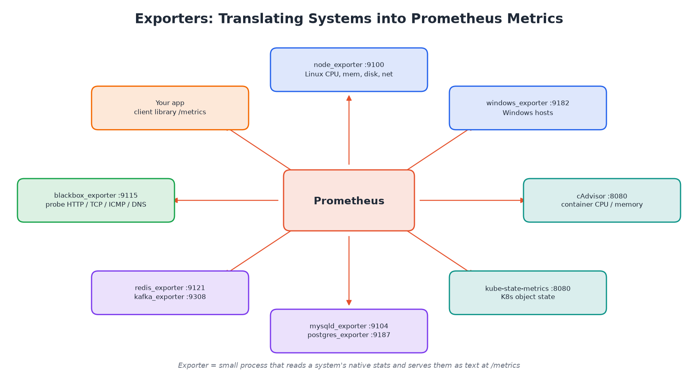

| Exporter | Port | What it monitors |
|----------|------|------------------|
| `node_exporter` | 9100 | Linux CPU, memory, disk, filesystem, network |
| `windows_exporter` | 9182 | Windows hosts |
| `blackbox_exporter` | 9115 | Probes HTTP, HTTPS, TCP, ICMP, DNS from outside |
| `cAdvisor` | 8080 | Container CPU/memory/network |
| `kube-state-metrics` | 8080 | Kubernetes objects (deployments, pods, restarts) |
| `mysqld_exporter` | 9104 | MySQL / MariaDB |
| `postgres_exporter` | 9187 | PostgreSQL |
| `redis_exporter` | 9121 | Redis |
| `nginx-prometheus-exporter` | 9113 | NGINX |
| `kafka_exporter` | 9308 | Kafka consumer lag, topics |

### 9.1 Try it now: node_exporter

```bash
docker run -d --name node-exporter -p 9100:9100 prom/node-exporter:v1.8.2
curl -s localhost:9100/metrics | grep -E "^node_load1|^node_memory_MemAvailable_bytes"
```

### 9.2 Blackbox probing example

```yaml
# prometheus.yml: check that https://example.com returns 2xx
- job_name: blackbox-http
  metrics_path: /probe
  params:
    module: [http_2xx]
  static_configs:
    - targets: ["https://example.com"]
  relabel_configs:
    - source_labels: [__address__]
      target_label: __param_target
    - source_labels: [__param_target]
      target_label: instance
    - target_label: __address__
      replacement: blackbox-exporter:9115
```

Then alert on `probe_success == 0` or `probe_ssl_earliest_cert_expiry - time() < 86400 * 14` (certificate expires in under 14 days).

---

## 10. Configuring Prometheus

**What it is:** Prometheus is configured with one YAML file, `prometheus.yml`.

```yaml
global:
  scrape_interval: 15s          # how often to scrape
  evaluation_interval: 15s      # how often to evaluate rules

rule_files:
  - /etc/prometheus/rules/*.yml

alerting:
  alertmanagers:
    - static_configs:
        - targets: ["alertmanager:9093"]

scrape_configs:
  - job_name: node
    static_configs:
      - targets: ["node-exporter:9100"]

  - job_name: sample-app
    scrape_interval: 5s
    static_configs:
      - targets: ["sample-app:8000"]
        labels:
          team: payments
```

The full lab config is in [`examples/observability-stack/prometheus/prometheus.yml`](examples/observability-stack/prometheus/prometheus.yml).

### 10.1 Service discovery

Static lists don't work when pods come and go every minute. Prometheus can discover targets:

| SD type | Use for |
|---------|---------|
| `kubernetes_sd_configs` | Pods, services, endpoints, nodes in K8s |
| `ec2_sd_configs` / `azure_sd_configs` / `gce_sd_configs` | Cloud VMs |
| `consul_sd_configs` | Services registered in Consul |
| `file_sd_configs` | A JSON/YAML file that another tool updates |

In Kubernetes with the Prometheus Operator, you usually write a **ServiceMonitor** instead: see [`examples/kubernetes/servicemonitor.yaml`](examples/kubernetes/servicemonitor.yaml).

### 10.2 Relabeling

Relabeling rewrites labels **before** scraping (`relabel_configs`) or **before** storing (`metric_relabel_configs`).

```yaml
relabel_configs:
  # only scrape pods with annotation prometheus.io/scrape: "true"
  - source_labels: [__meta_kubernetes_pod_annotation_prometheus_io_scrape]
    action: keep
    regex: "true"
  # copy the namespace into a normal label
  - source_labels: [__meta_kubernetes_namespace]
    target_label: namespace
metric_relabel_configs:
  # drop an expensive metric we never use
  - source_labels: [__name__]
    regex: "go_gc_duration_seconds.*"
    action: drop
```

### 10.3 Useful commands

```bash
promtool check config prometheus.yml           # validate config
promtool check rules rules/*.yml               # validate rules
curl -X POST localhost:9090/-/reload            # reload (needs --web.enable-lifecycle)
curl 'localhost:9090/api/v1/query?query=up'     # query via HTTP API
```

### 10.4 Storage and scaling

Prometheus stores data on local disk (default retention 15 days). It is a **single node** by design. For long-term storage, high availability and a global view across clusters, teams add:

| Tool | Idea |
|------|------|
| **Thanos** | Sidecar uploads blocks to S3; global query across many Prometheus |
| **Grafana Mimir** / **Cortex** | Horizontally scalable, multi-tenant Prometheus via `remote_write` |
| **VictoriaMetrics** | Fast, resource-efficient Prometheus-compatible TSDB |

---

## 11. PromQL Basics

**What it is:** PromQL (Prometheus Query Language) is how you ask questions of your metrics. It powers dashboards, alerts and ad-hoc debugging.

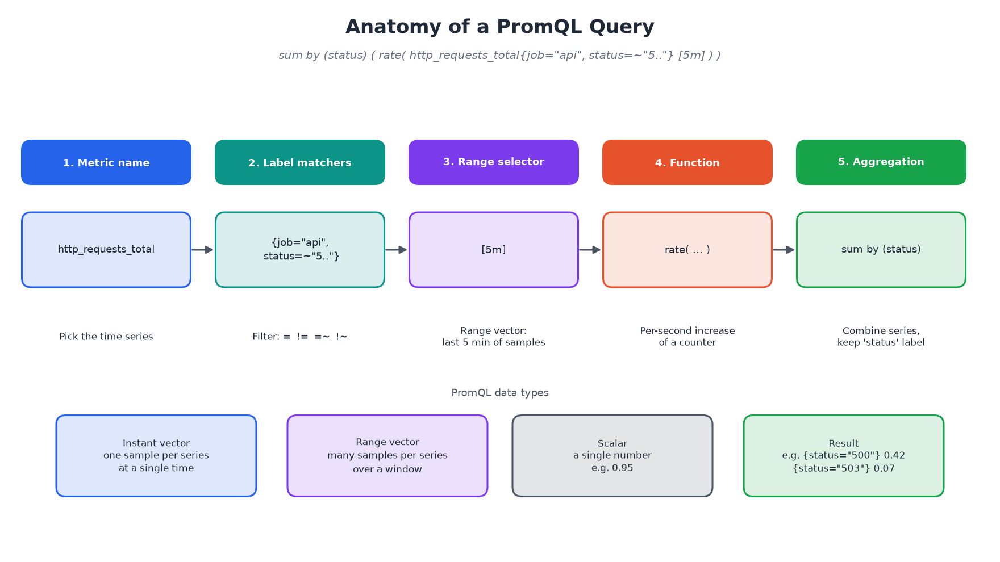

### 11.1 Data types

| Type | Example | Meaning |
|------|---------|---------|
| **Instant vector** | `http_requests_total` | Latest value of each series |
| **Range vector** | `http_requests_total[5m]` | All samples in the last 5 minutes |
| **Scalar** | `0.95` | A plain number |
| **String** | `"hello"` | Rarely used |

### 11.2 Selectors and matchers

| Matcher | Example | Meaning |
|---------|---------|---------|
| `=` | `{job="api"}` | Equals |
| `!=` | `{status!="200"}` | Not equals |
| `=~` | `{status=~"5.."}` | Regex match |
| `!~` | `{route!~"/health.*"}` | Regex not match |

### 11.3 Operators

```promql
node_memory_MemAvailable_bytes / 1024 / 1024           # arithmetic → MiB
node_load1 > 4                                         # comparison filter
up == 0                                                # which targets are down
rate(errors_total[5m]) / rate(requests_total[5m])     # ratio of two metrics
```

### 11.4 Try it now

Open http://localhost:9090 (from the lab) and run:

```promql
up
http_requests_total
http_requests_total{route="/api/orders"}
rate(http_requests_total[1m])
sum by (status) (rate(http_requests_total[1m]))
```

Click the **Graph** tab to see each one over time.

---

## 12. PromQL in Practice

### 12.1 `rate()` vs `irate()` vs `increase()`

| Function | Returns | Use for |
|----------|---------|---------|
| `rate(x[5m])` | Average per-second rate over 5 minutes | Alerts and dashboards (smooth) |
| `irate(x[5m])` | Per-second rate from the last 2 samples | Spotting short spikes |
| `increase(x[1h])` | Total increase over 1 hour | "How many errors in the last hour?" |

> ⚠ **Warning:** Always `rate()` **before** `sum()`. `sum(rate(x[5m]))` ✅ ; `rate(sum(x)[5m])` ❌ (breaks counter-reset handling).

### 12.2 Aggregation

```promql
sum(rate(http_requests_total[5m]))                          # total RPS
sum by (route) (rate(http_requests_total[5m]))              # RPS per route
sum without (instance) (rate(http_requests_total[5m]))      # drop one label
topk(3, sum by (route) (rate(http_requests_total[5m])))     # top 3 busiest routes
count(up == 1)                                              # healthy targets
```

### 12.3 Percentiles with histograms

```promql
# p95 latency of the whole service
histogram_quantile(0.95,
  sum by (le) (rate(http_request_duration_seconds_bucket[5m])))

# p95 per route (keep 'le' AND the label you want)
histogram_quantile(0.95,
  sum by (route, le) (rate(http_request_duration_seconds_bucket[5m])))
```

> 💡 **Tip:** Why percentiles and not averages? If 99 requests take 10ms and 1 takes 10s, the average is ~110ms (looks fine) but 1% of users waited 10 seconds. **p95/p99** show what your slowest users feel.

### 12.4 Recording rules

Expensive queries used by many dashboards should be pre-computed:

```yaml
groups:
  - name: sample-app-recording
    rules:
      - record: route:http_requests:rate5m
        expr: sum by (route) (rate(http_requests_total[5m]))
```

Naming convention: `level:metric:operations`. See [`examples/observability-stack/prometheus/rules/recording-rules.yml`](examples/observability-stack/prometheus/rules/recording-rules.yml).

More queries: [`examples/queries/promql-cheatsheet.md`](examples/queries/promql-cheatsheet.md).

---

## 13. Alerting Rules

**What it is:** An alerting rule is a PromQL expression that, when it returns results for long enough, fires an alert.

```yaml
groups:
  - name: sample-app-red
    rules:
      - alert: HighErrorRate
        expr: |
          sum(rate(http_requests_total{status=~"5.."}[5m]))
          / sum(rate(http_requests_total[5m])) > 0.05
        for: 2m                          # must be true for 2 minutes
        labels:
          severity: warning              # used by Alertmanager for routing
        annotations:
          summary: "Error rate above 5%"
          description: "{{ $value | humanizePercentage }} of requests failing"
          runbook_url: "https://wiki.example.com/runbooks/high-error-rate"
```

Alert states:

| State | Meaning |
|-------|---------|
| **Inactive** | Expression returns nothing |
| **Pending** | Expression true, waiting for `for:` duration |
| **Firing** | True for longer than `for:` → sent to Alertmanager |

### 13.1 Good alerts vs bad alerts

| ✅ Good alert | ❌ Bad alert |
|--------------|-------------|
| Based on **symptoms** users feel (errors, latency, SLO burn) | Based on causes that may not matter (CPU 80%) |
| **Actionable**: someone must do something now | "FYI" alerts nobody acts on |
| Has a **runbook** link | Mystery alert with no context |
| Uses `for:` to avoid flapping | Fires and resolves every 30 seconds |
| Severity matches urgency | Everything is "critical" |

> ⚠ **Warning:** **Alert fatigue** is real. If on-call gets 50 alerts a night, they will start ignoring them, including the real one. Every alert must be worth waking up for, or it should be a ticket/dashboard instead.

---

## 14. Alertmanager

**What it is:** Alertmanager receives alerts from Prometheus and decides **who gets notified, how, and how often**. It handles deduplication, grouping, inhibition, silencing and routing.

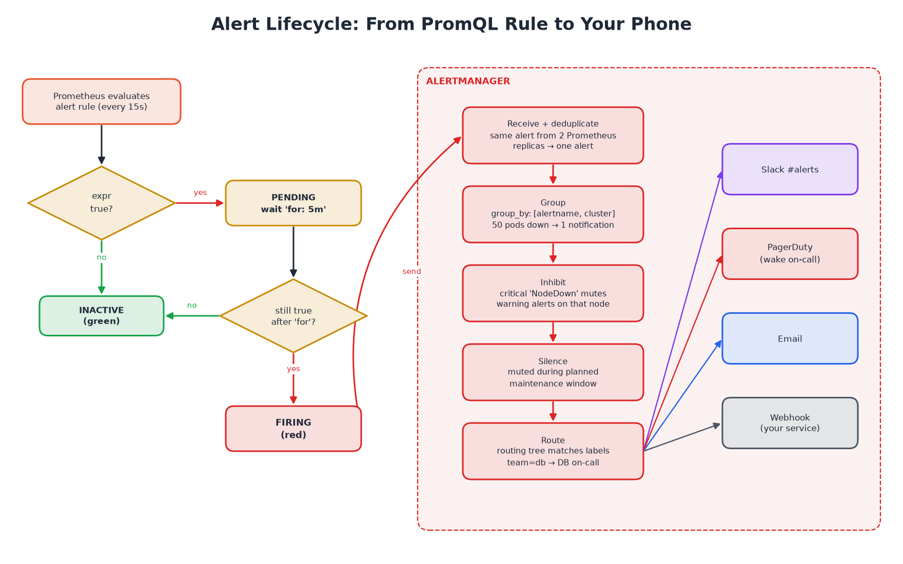

| Feature | What it does | Example |
|---------|--------------|---------|
| **Deduplication** | Two Prometheus replicas send the same alert → one notification | HA setup |
| **Grouping** | Combine related alerts into one message | 50 pods down → 1 Slack message |
| **Inhibition** | A bigger alert mutes smaller ones | `NodeDown` mutes `PodNotReady` on that node |
| **Silences** | Mute alerts for a time window | Planned maintenance 22:00–23:00 |
| **Routing** | Send alerts to the right team/channel by labels | `team=db` → DB on-call PagerDuty |

### 14.1 Configuration

```yaml
route:
  receiver: default-slack
  group_by: [alertname, cluster]
  group_wait: 30s          # wait to collect alerts before first notification
  group_interval: 5m       # wait before notifying about new alerts in the group
  repeat_interval: 4h      # re-notify if still firing
  routes:
    - matchers: [severity="critical"]
      receiver: pagerduty-oncall
    - matchers: [team="database"]
      receiver: db-team-slack

inhibit_rules:
  - source_matchers: [severity="critical"]
    target_matchers: [severity="warning"]
    equal: [instance]

receivers:
  - name: default-slack
    slack_configs:
      - api_url: https://hooks.slack.com/services/XXX
        channel: "#alerts"
  - name: pagerduty-oncall
    pagerduty_configs:
      - routing_key: <key>
  - name: db-team-slack
    slack_configs:
      - api_url: https://hooks.slack.com/services/YYY
        channel: "#db-alerts"
```

Lab config: [`examples/observability-stack/alertmanager/alertmanager.yml`](examples/observability-stack/alertmanager/alertmanager.yml). In the lab, alerts are sent to a webhook on the sample app, so you can **see them arrive in the logs**.

### 14.2 Try it now

```bash
amtool check-config alertmanager.yml                          # validate
amtool --alertmanager.url=http://localhost:9093 alert query    # list alerts
amtool --alertmanager.url=http://localhost:9093 silence add alertname=HighErrorRate \
  --duration=1h --comment="testing silences"                   # create a silence
```

---

## 15. Grafana: Dashboards

**What it is:** Grafana is an open-source visualization platform. It connects to many **data sources** (Prometheus, Loki, Elasticsearch, Tempo, Jaeger, SQL, cloud services) and shows them in **dashboards** made of **panels**.

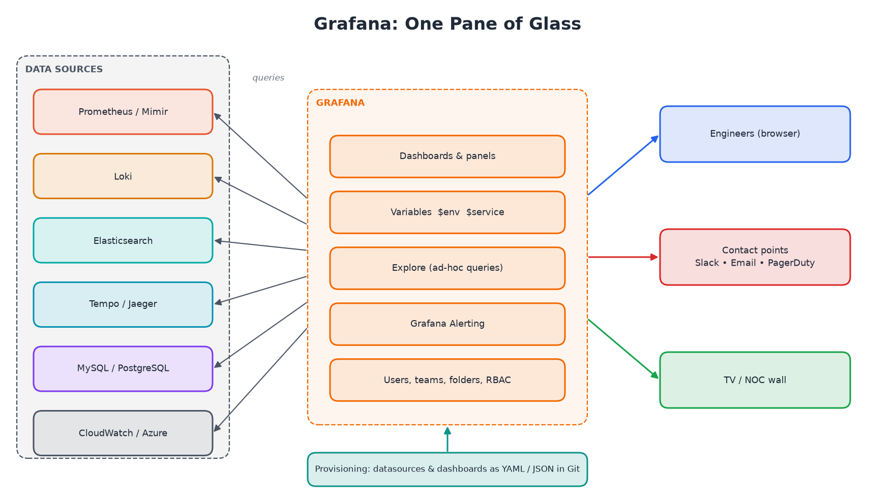

**Why DevOps people care:** Grafana is the "single pane of glass." The same tool shows metrics, logs and traces side by side, and the LGTM stack (**L**oki, **G**rafana, **T**empo, **M**imir) is a popular fully open-source observability platform.

### 15.1 Key concepts

| Concept | Meaning |
|---------|---------|
| **Data source** | Where data comes from (Prometheus URL, Loki URL…) |
| **Dashboard** | A page of panels, saved as JSON |
| **Panel** | One visualization: time series, stat, gauge, table, heatmap, logs, traces |
| **Variable** | Dropdown like `$env` or `$instance` that changes all queries |
| **Explore** | Ad-hoc query mode for debugging |
| **Folder / permissions** | Organize dashboards per team |
| **Provisioning** | Define data sources and dashboards as files in Git |

### 15.2 Try it now

1. Start the lab and open http://localhost:3000 (admin / admin).
2. Go to **Dashboards → Observability Lab → Sample App - RED + Logs**.
3. Click **Edit** on a panel to see its PromQL.
4. Create a variable: **Dashboard settings → Variables → New** → type *Query*, query `label_values(http_requests_total, route)`, name `route`. Then use `{route="$route"}` in a panel.
5. Import a community dashboard: **Dashboards → New → Import → ID `1860`** (Node Exporter Full).

### 15.3 Dashboards as code

Never build important dashboards only by clicking. Store them in Git:

```yaml
# grafana/provisioning/datasources/datasources.yml
apiVersion: 1
datasources:
  - name: Prometheus
    type: prometheus
    url: http://prometheus:9090
    isDefault: true
```

See [`examples/observability-stack/grafana/`](examples/observability-stack/grafana/). Other "as code" options: **Terraform Grafana provider**, **Grafonnet** (Jsonnet), **Grafana Operator** in Kubernetes.

---

## 16. Dashboard Design

**What it is:** A good dashboard answers "is it healthy?" in **5 seconds**, and "where should I look?" in **30 seconds**.

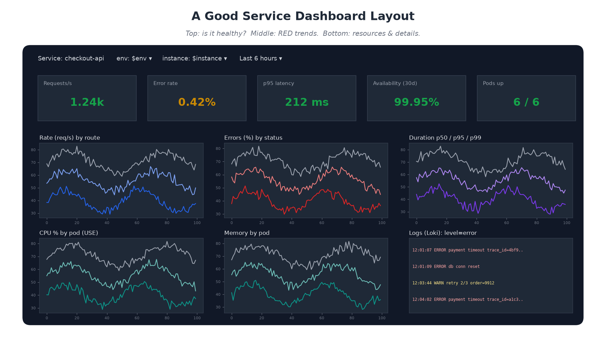

| Rule | Why |
|------|-----|
| Top row: **stat panels** for the key SLIs (RPS, error %, p95, availability) | Instant health check |
| Middle: **RED** time series | Trends and when the problem started |
| Bottom: **USE** for resources + logs panel | Details and causes |
| Use **variables** (`$env`, `$service`) instead of copying dashboards | One dashboard for all environments |
| Use **thresholds** and consistent colors (green/orange/red) | Eyes find problems fast |
| Put **units** on every panel (s, bytes, %, reqps) | No guessing |
| Add **annotations** for deploys | "Did the deploy cause this?" |
| Fewer, focused dashboards | 300 abandoned dashboards help nobody |

---

## 17. Grafana Alerting

**What it is:** Grafana can also evaluate alert rules on **any** data source (Prometheus, Loki, SQL, CloudWatch) and send notifications.

| Concept | Meaning |
|---------|---------|
| **Alert rule** | Query + condition + evaluation interval + pending period |
| **Contact point** | Where to send: Slack, email, PagerDuty, Teams, webhook |
| **Notification policy** | Routing tree by labels (like Alertmanager routes) |
| **Silence / mute timing** | Mute alerts temporarily or on a schedule (e.g. weekends) |

**Prometheus rules + Alertmanager vs Grafana Alerting:**

| | Prometheus + Alertmanager | Grafana Alerting |
|---|---|---|
| Data sources | Prometheus only | Many |
| Config | YAML in Git (GitOps friendly) | UI, API, or provisioning files |
| Best for | Kubernetes / Prometheus-centric teams | Mixed data sources, UI-driven teams |

> 💡 **Tip:** Pick **one** alerting system per team. Two systems sending overlapping alerts = confusion.

---

## 18. Other Monitoring Tools: Datadog, New Relic, Zabbix, Nagios

**What it is:** Prometheus + Grafana is not the only option. You will meet these tools in real companies.

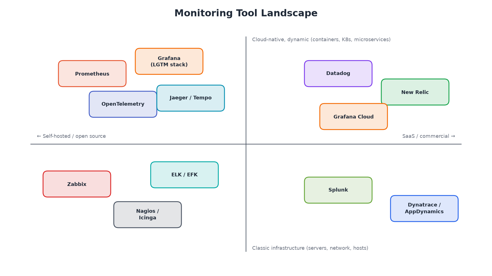

### 18.1 Datadog

SaaS observability platform. Install the **Datadog Agent** on hosts/K8s, and it pushes metrics, logs, traces (APM), security signals and more to Datadog's cloud. Huge integration catalog (750+), great UX, but cost grows quickly with hosts, custom metrics and log volume.

```bash
# Kubernetes install via Helm (API key from your Datadog account)
helm repo add datadog https://helm.datadoghq.com
helm install datadog-agent datadog/datadog \
  --set datadog.apiKey=<DD_API_KEY> --set datadog.site=datadoghq.com \
  --set datadog.logs.enabled=true --set datadog.apm.portEnabled=true
```

### 18.2 New Relic

SaaS **APM-first** platform. Language agents auto-instrument apps (Java, .NET, Node, Python, PHP, Go). All data goes into NRDB and is queried with **NRQL**:

```sql
SELECT percentile(duration, 95) FROM Transaction
WHERE appName = 'checkout-api' SINCE 1 hour ago TIMESERIES
```

Pricing is based on data ingested and user seats. It also accepts OpenTelemetry data natively.

### 18.3 Zabbix

Open-source, **enterprise infrastructure** monitoring (servers, network devices, VMs). Uses a **Zabbix server + database (MySQL/PostgreSQL) + web UI**, with **Zabbix agents** on hosts, plus SNMP, IPMI and JMX. Configuration is template-based (e.g. "Linux by Zabbix agent"). Very strong for network gear and traditional data centers.

### 18.4 Nagios

The classic (1999) open-source **check-based** monitoring tool. It runs **plugins** that return `OK / WARNING / CRITICAL / UNKNOWN` (exit codes 0/1/2/3):

```bash
/usr/lib/nagios/plugins/check_disk -w 20% -c 10% -p /
# DISK OK - free space: / 31000 MB (62% inode=91%)
```

Still found in many companies (and forks: **Icinga**, **Naemon**). It is great for "is it up?" checks, but weak at time-series metrics and dynamic cloud environments.

### 18.5 Comparison

| | Prometheus + Grafana | Datadog | New Relic | Zabbix | Nagios |
|---|---|---|---|---|---|
| Type | OSS, self-hosted | SaaS | SaaS | OSS, self-hosted | OSS (+ commercial XI) |
| Model | Pull | Push (agent) | Push (agent) | Agent push/pull + SNMP | Active checks |
| Strength | Cloud-native, K8s, PromQL | All-in-one, integrations, UX | APM, code-level insight | Network & classic infra | Simple up/down checks |
| Weakness | You run & scale it | Cost at scale | Cost, vendor lock-in | Less cloud-native | Old UI, no real metrics DB |
| Query language | PromQL | Datadog query / UI | NRQL | UI + triggers | n/a |
| Typical user | Startups to big tech on K8s | Fast-moving teams with budget | App-centric teams | Enterprises, ISPs, telcos | Legacy / small ops teams |

> 💡 **Tip:** Interviewers love "Why Prometheus over Datadog?" A good answer is about trade-offs: **cost and control** (self-hosted OSS) vs **speed and convenience** (SaaS). With OpenTelemetry you can keep the option to switch.


---

# PART 3: Logging

## 19. Logging Fundamentals

**What it is:** A log is a timestamped record of an event. Apps, operating systems, web servers, databases, Kubernetes and cloud providers all write logs.

**Why DevOps people care:** Metrics tell you the error rate went up. Logs tell you the actual error message, stack trace and the request that caused it. Logs are also required for **security audits and compliance**.

### 19.1 Log levels

| Level | Use for | Example |
|-------|---------|---------|
| `TRACE` / `DEBUG` | Developer detail, off in prod | `cache miss key=user:42` |
| `INFO` | Normal important events | `order 9912 created` |
| `WARN` | Something odd, but handled | `retry 2/3 calling payment API` |
| `ERROR` | A request/operation failed | `payment failed: card declined` |
| `FATAL` / `CRITICAL` | The app cannot continue | `cannot connect to database, exiting` |

### 19.2 Unstructured vs structured logs

```text
# ❌ Unstructured: needs fragile regex to parse
2026-11-20 10:01:07 ERROR Payment failed for user 42 order 9912 after 2300ms

# ✅ Structured JSON: every field is searchable
{"ts":"2026-11-20T10:01:07Z","level":"error","msg":"payment failed",
 "user_id":42,"order_id":9912,"duration_ms":2300,"trace_id":"4bf92f35..."}
```

### 19.3 Logging best practices

| ✅ Do | ❌ Don't |
|------|---------|
| Log in **JSON** with consistent field names | Mix formats across services |
| In containers, log to **stdout/stderr** | Write to files inside the container |
| Include `trace_id`, `service`, `env`, `version` | Log without context |
| Use correct levels | Log everything as ERROR |
| **Mask secrets and PII** (passwords, tokens, cards, emails) | Log `Authorization` headers or full request bodies |
| Set **retention** (e.g. 7d hot, 30d warm, 1y archive) | Keep everything forever (expensive!) |
| Sample or drop noisy logs (health checks) | Pay to store 1 million `GET /healthz` lines |

> ⚠ **Warning:** Logging a password or credit card number is a **security incident**. Logs get copied to many systems and kept for a long time.

### 19.4 Try it now: where do logs live?

```bash
# Linux system logs
journalctl -u nginx --since "10 min ago"
tail -f /var/log/syslog

# Docker
docker logs -f --tail 50 sample-app

# Kubernetes
kubectl logs -f deploy/sample-app -n shop
kubectl logs <pod> --previous           # logs of the crashed container
ls /var/log/containers/                  # on the node: where log agents read from
```

---

## 20. The Log Pipeline

**What it is:** Every logging system, from ELK to Splunk, follows the same pipeline.

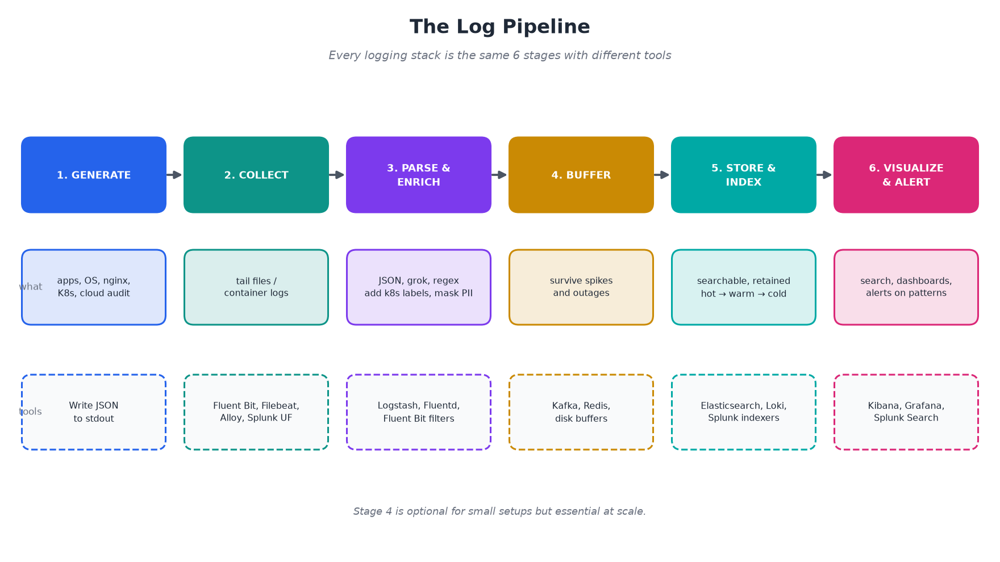

| Stage | Job | Tools |
|-------|-----|-------|
| 1. Generate | App/OS writes the log | Your code, nginx, systemd, K8s |
| 2. Collect | Read files/streams on each host | Fluent Bit, Filebeat, Grafana Alloy, Splunk UF, OTel Collector |
| 3. Parse & enrich | Split into fields, add metadata, mask PII | Logstash, Fluentd, Fluent Bit filters |
| 4. Buffer | Absorb spikes, survive outages | Kafka, Redis, disk buffers |
| 5. Store & index | Make it searchable, apply retention | Elasticsearch/OpenSearch, Loki, Splunk |
| 6. Visualize & alert | Search, dashboards, alerts | Kibana, Grafana, Splunk Search |

---

## 21. ELK vs EFK Stack

**What it is:**

- **ELK** = **E**lasticsearch + **L**ogstash + **K**ibana (usually with **Beats**, so it's also called the **Elastic Stack**)
- **EFK** = **E**lasticsearch + **F**luentd/**F**luent Bit + **K**ibana. Common in **Kubernetes**.

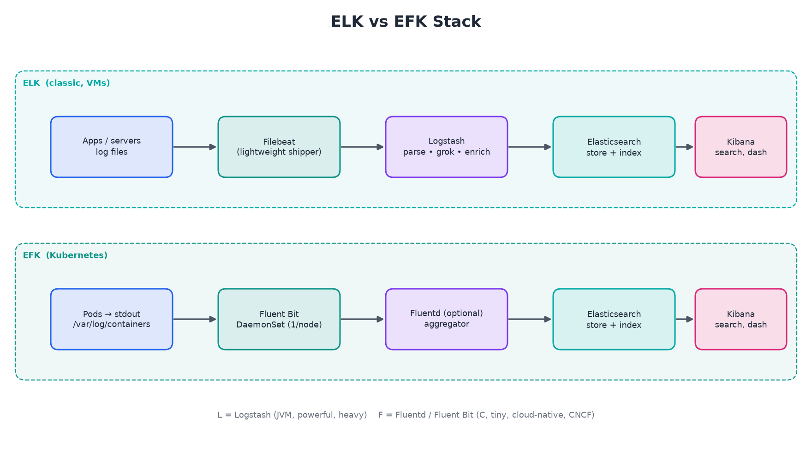

| | ELK | EFK |
|---|---|---|
| Collector/processor | Filebeat + Logstash | Fluent Bit (+ optional Fluentd) |
| Language | Logstash: JRuby on the JVM | Fluent Bit: C; Fluentd: Ruby + C |
| Memory | Logstash: ~1 GB | Fluent Bit: a few MB |
| Plugins | Very rich filters (grok, geoip…) | Rich (Fluentd 1000+ plugins) |
| Typical home | VMs, classic servers | Kubernetes (CNCF projects) |

> 💡 **Tip:** After Elastic's license change in 2021, AWS forked Elasticsearch and Kibana into **OpenSearch** and **OpenSearch Dashboards** (Apache 2.0). They work almost the same way. Elastic later added AGPL as a license option again in 2024.

### 21.1 Try it now: run the EFK lab

```bash
cd examples/efk-stack
docker compose up -d
docker compose ps                         # wait until all are running (~1 min)
curl -s localhost:9200/_cat/indices?v      # see fluentbit-app-* and logstash-access-*
```

Open Kibana at http://localhost:5601 → **Stack Management → Data Views → Create** → pattern `fluentbit-app-*`, timestamp `@timestamp` → **Discover**. Do the same for `logstash-access-*`.

---

## 22. Elasticsearch

**What it is:** A distributed search and analytics engine built on Apache Lucene. It stores JSON **documents** in **indices** and builds an **inverted index** so full-text search is fast.

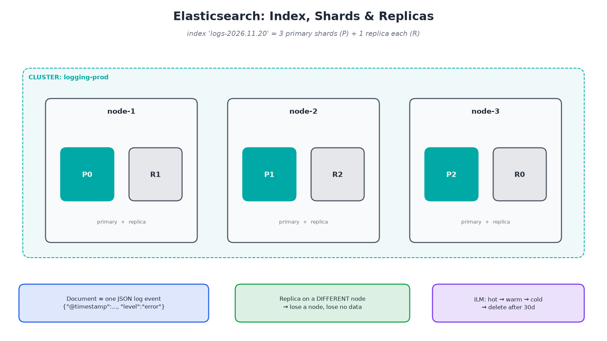

| Concept | Meaning | SQL-ish analogy |
|---------|---------|-----------------|
| **Document** | One JSON log event | Row |
| **Index** | Collection of documents, e.g. `logs-2026.11.20` | Table |
| **Mapping** | Field types (keyword, text, date, long) | Schema |
| **Shard** | A slice of an index (a Lucene index) | Partition |
| **Replica** | Copy of a shard on another node | Backup copy |
| **Node / cluster** | One ES process / a group of nodes | Server / cluster |

Cluster health: 🟢 **green** = all shards assigned; 🟡 **yellow** = some replicas unassigned (normal on single node); 🔴 **red** = some primary shards missing (data unavailable!).

### 22.1 Index Lifecycle Management (ILM)

Logs are valuable for days and rarely needed after weeks. ILM moves data through phases automatically:

```text
HOT (fast SSD, writes) → WARM (read-only, cheaper) → COLD (rarely searched) → DELETE (after 30d)
```

### 22.2 Try it now

```bash
curl -s localhost:9200/_cluster/health?pretty
curl -s localhost:9200/_cat/indices?v
curl -s -H 'Content-Type: application/json' 'localhost:9200/fluentbit-app-*/_search?pretty' -d '{
  "size": 3, "sort": [{"@timestamp": "desc"}], "query": {"term": {"level": "error"}}
}'
```

More: [`examples/queries/kql-spl-traceql-cheatsheet.md`](examples/queries/kql-spl-traceql-cheatsheet.md).

---

## 23. Logstash

**What it is:** A server-side data processing pipeline: **input → filter → output**. Its superpower is parsing messy text with **grok**.

```ruby
input {
  file { path => "/logs/access.log"  start_position => "beginning" }
  # also: beats { port => 5044 }, kafka { ... }, syslog { ... }
}
filter {
  grok   { match => { "message" => "%{COMBINEDAPACHELOG}" } }   # parse nginx line
  date   { match => [ "timestamp", "dd/MMM/yyyy:HH:mm:ss Z" ] }  # use log time
  mutate { add_field => { "environment" => "lab" } }
  # geoip { source => "[source][address]" }                     # IP → country/city
}
output {
  elasticsearch { hosts => ["http://elasticsearch:9200"]  index => "logstash-access-%{+YYYY.MM.dd}" }
}
```

What grok does to one line:

```text
INPUT:  10.0.0.12 - - [20/Nov/2026:10:01:07 +0000] "GET /api/orders HTTP/1.1" 500 1234 "-" "curl/8.4.0"
OUTPUT: source.address=10.0.0.12  http.request.method=GET  url.original=/api/orders
        http.response.status_code=500  http.response.body.bytes=1234  user_agent.original=curl/8.4.0
```

Lab pipeline: [`examples/efk-stack/logstash/pipeline/access-logs.conf`](examples/efk-stack/logstash/pipeline/access-logs.conf).

> 💡 **Tip:** Test grok patterns in Kibana → **Dev Tools → Grok Debugger** before deploying.

---

## 24. Fluentd and Fluent Bit

**What it is:** Two CNCF graduated log processors from the same family.

| | Fluent Bit | Fluentd |
|---|---|---|
| Written in | C | Ruby + C |
| Memory | ~1 MB to tens of MB | ~40 MB+ |
| Role | **Collector/forwarder** on every node | **Aggregator** with heavy processing |
| Plugins | ~100 built-in | 1000+ community |
| K8s pattern | DaemonSet | Deployment / StatefulSet |

Common pattern: **Fluent Bit on every node → (optional) Fluentd aggregator → Elasticsearch/Loki/S3**. Many teams now use Fluent Bit alone.

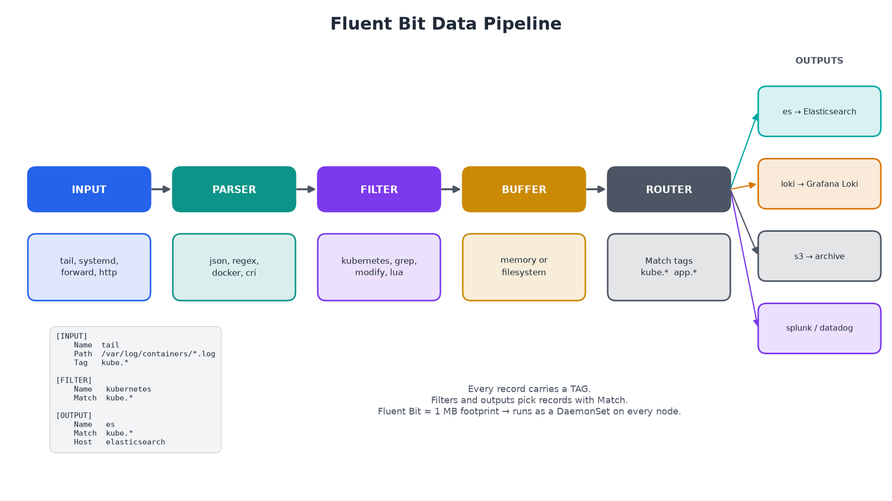

```ini
[INPUT]
    Name    tail
    Path    /logs/app.log
    Tag     app.shop
    Parser  json

[FILTER]
    Name     grep
    Match    app.*
    Exclude  route ^/healthz$

[OUTPUT]
    Name                es
    Match               app.*
    Host                elasticsearch
    Logstash_Format     On
    Logstash_Prefix     fluentbit-app
    Suppress_Type_Name  On
```

> 💡 **Tip:** **Tags** and **Match** are the key idea. Every record gets a tag on input; filters and outputs pick records by matching tags (`app.*`, `kube.*`).

Files: [`examples/efk-stack/fluent-bit/`](examples/efk-stack/fluent-bit/) and the Kubernetes DaemonSet [`examples/kubernetes/fluent-bit-daemonset.yaml`](examples/kubernetes/fluent-bit-daemonset.yaml).

### 24.1 Try it now

```bash
docker logs -f fluent-bit               # see records flowing (stdout output)
# Edit fluent-bit.conf: add "Exclude level ^info$" to the grep filter, then:
docker compose restart fluent-bit
```

---

## 25. Kibana

**What it is:** The web UI for Elasticsearch: search logs, build visualizations and dashboards, and manage the cluster.

| Feature | Use |
|---------|-----|
| **Discover** | Search and filter raw log events |
| **Data views** | Tell Kibana which indices to search (`fluentbit-app-*`) |
| **Lens / Visualize** | Drag-and-drop charts |
| **Dashboards** | Combine visualizations |
| **Dev Tools** | Run Elasticsearch API calls in the browser |
| **Alerts / Rules** | Alert on log patterns or thresholds |

### 25.1 KQL (Kibana Query Language)

```text
level : "error"
level : "error" and route : "/api/orders"
status >= 500 and not route : "/healthz"
msg : "database timeout"
```

> 💡 **Tip:** Fields you filter on exactly should be `keyword` type, while free text should be `text`. If a filter doesn't work, check the field mapping.

---

## 26. Grafana Loki

**What it is:** A log aggregation system from Grafana Labs, "**like Prometheus, but for logs**." Loki **does not index the full text** of logs. It only indexes a small set of **labels** and stores compressed log chunks in cheap object storage (S3, GCS, Azure Blob, or local disk).

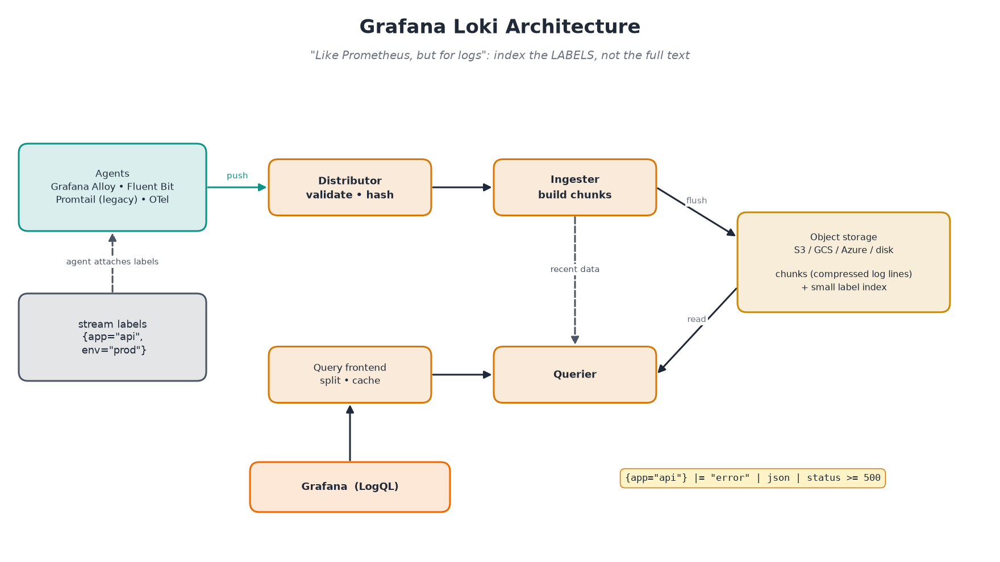

**Why DevOps people care:** Much cheaper and simpler to run than Elasticsearch for most "search my app logs" use cases, and it shares labels with Prometheus, so jumping from a metric to its logs is one click in Grafana.

| | Loki | Elasticsearch |
|---|---|---|
| Indexes | Labels only | Every field / full text |
| Storage cost | 💚 Low (object storage) | 🟠 High (big indices, SSDs) |
| Query speed for full-text search over huge ranges | 🟡 Slower (brute-force scan of chunks) | 💚 Fast |
| Operational effort | Lower | Higher (JVM, shards, mappings) |
| Query language | LogQL | KQL / Lucene / ES DSL / ES\|QL |
| UI | Grafana | Kibana |

**Collecting logs for Loki:** **Grafana Alloy** (the current recommended agent; **Promtail** is deprecated and reached end-of-life), Fluent Bit, or the OpenTelemetry Collector. Lab config: [`examples/observability-stack/alloy/config.alloy`](examples/observability-stack/alloy/config.alloy).

### 26.1 LogQL

```logql
{service_name="sample-app"}                                       # stream selector
{service_name="sample-app"} |= "payment"                          # line contains
{service_name="sample-app"} | json | level="error"                # parse JSON + filter
sum by (level) (rate({service_name="sample-app"}[1m]))            # logs → metric
```

> ⚠ **Warning:** Labels in Loki must be **low cardinality**. `trace_id` or `user_id` as a label will create millions of streams and hurt performance. Keep them in the log line and use `|=` filters.

More: [`examples/queries/logql-cheatsheet.md`](examples/queries/logql-cheatsheet.md).

### 26.2 Try it now

In the lab, open Grafana → **Explore** → data source **Loki** → run:

```logql
{service_name="sample-app"} | json | level="error"
```

Click a log line → **TraceID** link → it opens the trace in Jaeger. That is **logs → traces correlation**.

---

## 27. Splunk

**What it is:** A commercial platform for searching, monitoring and analyzing machine data. It is very popular in **enterprises and security teams (SIEM)**. Splunk uses **schema-on-read**: it stores raw events and extracts fields at search time.

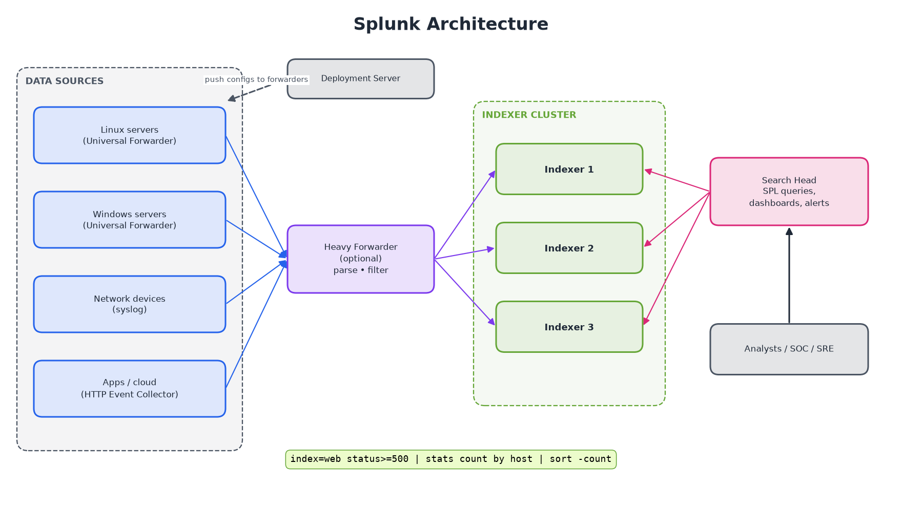

| Component | Job |
|-----------|-----|
| **Universal Forwarder (UF)** | Lightweight agent that ships raw data |
| **Heavy Forwarder (HF)** | Optional: parses/filters/routes before indexing |
| **Indexer** | Stores and indexes data (clustered for HA) |
| **Search Head** | UI and SPL query engine, dashboards, alerts |
| **Deployment Server** | Pushes configs to thousands of forwarders |
| **HEC** (HTTP Event Collector) | Send events over HTTPS from apps/cloud |

### 27.1 SPL (Search Processing Language)

```text
index=web status>=500 | stats count by host, uri_path | sort -count
index=app level=error | timechart span=5m count by service
index=security action=failure | stats count by src_ip | where count > 20
```

SPL uses a **pipe** model like Linux: each command transforms the results of the previous one.

| | Splunk | ELK / Loki |
|---|---|---|
| License | Commercial (priced by ingest or compute) | Open source / open core |
| Strength | Enterprise features, security (Splunk ES), support | Cost, flexibility, cloud-native |
| Weakness | Expensive at high volume | You operate it yourself |

---

## 28. Choosing a Logging Stack

| Situation | Good choice |
|-----------|-------------|
| Kubernetes, already using Prometheus + Grafana, cost-sensitive | **Loki + Alloy/Fluent Bit** |
| Need powerful full-text search, analytics, SIEM-like use | **Elasticsearch/OpenSearch + Fluent Bit/Logstash + Kibana** |
| Large enterprise, security/compliance team, budget | **Splunk** |
| Want SaaS, zero ops | **Datadog Logs, New Relic Logs, Grafana Cloud, Elastic Cloud** |
| AWS-native, simple needs | **CloudWatch Logs** |

```text
Need full-text search on everything, fast? ── yes ──► Elasticsearch / OpenSearch / Splunk
          │ no
          ▼
Already on Grafana + Prometheus? ──────────── yes ──► Loki
          │ no
          ▼
Small team, no time to operate? ───────────── yes ──► SaaS (Datadog / New Relic / Grafana Cloud)
          │ no
          ▼
Start with Loki or EFK and grow
```

---

# PART 4: Tracing and Observability

## 29. Distributed Tracing Concepts

**What it is:** Distributed tracing follows **one request** as it travels through many services, and records how long each step took.

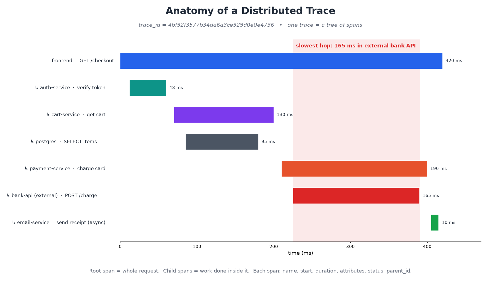

| Term | Meaning |
|------|---------|
| **Trace** | The whole journey of one request. Identified by a `trace_id` |
| **Span** | One unit of work (HTTP call, DB query, function). Has `span_id`, `parent_span_id`, name, start, duration |
| **Root span** | The first span, with no parent |
| **Attributes / tags** | Key-value details: `http.route=/api/orders`, `db.system=postgresql` |
| **Span events** | Timestamped notes inside a span (e.g. exception thrown) |
| **Status** | `OK`, `ERROR`, or `UNSET` |
| **Span kind** | `SERVER`, `CLIENT`, `PRODUCER`, `CONSUMER`, `INTERNAL` |

**Why DevOps people care:** In a monolith, a stack trace shows the problem. In microservices, one click can touch 20 services. Without traces, "checkout is slow" means checking 20 dashboards. With traces, you see the slow hop immediately in the waterfall.

**What traces give you:**

- The **critical path** (what actually made the request slow)
- **Service dependency maps** generated automatically
- **Error source**: which service started the failure
- **RED metrics** per service (derived from spans)

---

## 30. Context Propagation

**What it is:** How service B knows it is part of the same trace as service A. The trace context is passed in **HTTP headers** (or message headers for Kafka/RabbitMQ).

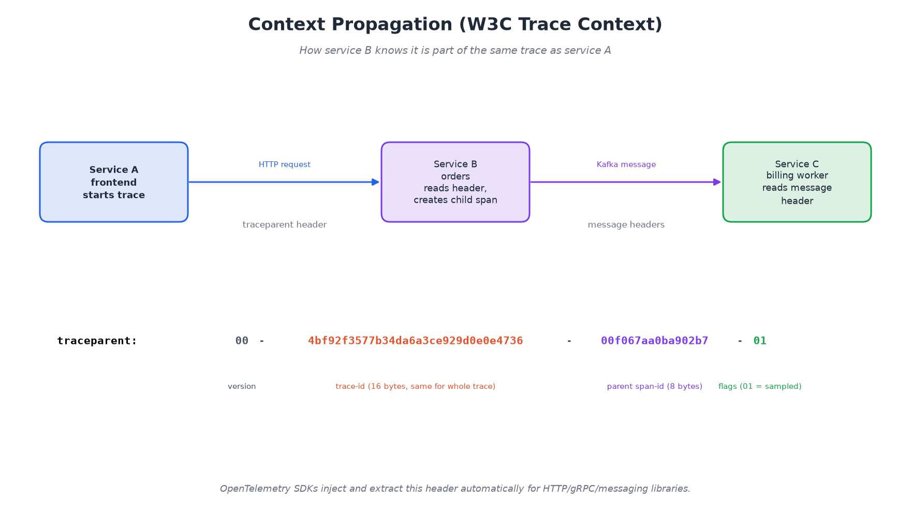

The standard is **W3C Trace Context**:

```text
traceparent: 00-4bf92f3577b34da6a3ce929d0e0e4736-00f067aa0ba902b7-01
             │  │                                │                └ flags (01 = sampled)
             │  │                                └ parent span id (8 bytes)
             │  └ trace id (16 bytes, same for the whole trace)
             └ version
tracestate: vendor-specific extra data (optional)
```

Older formats you might see: **B3** (Zipkin: `X-B3-TraceId`, `X-B3-SpanId`), **Jaeger** (`uber-trace-id`).

> ⚠ **Warning:** If **one** service in the chain (e.g. an old proxy) drops the header, the trace breaks into two separate traces. Make sure gateways, load balancers and message libraries propagate `traceparent`.

---

## 31. Jaeger

**What it is:** An open-source distributed tracing platform created at Uber, now a **CNCF graduated** project. It receives spans, stores them, and gives you a UI to search and visualize traces.

| Component | Job |
|-----------|-----|
| **Collector** | Receives spans (OTLP gRPC 4317 / HTTP 4318) |
| **Storage** | Elasticsearch/OpenSearch, Cassandra, Badger, Kafka, or memory |
| **Query + UI** | Search traces, view waterfalls, compare traces, dependency graph (port 16686) |
| **all-in-one** | Everything in a single container for labs |

> 💡 **Tip:** Jaeger's own client SDKs are retired. Instrument with **OpenTelemetry** and send OTLP to Jaeger. Jaeger v2 is itself built on the OpenTelemetry Collector.

### 31.1 Try it now

```bash
docker run -d --name jaeger -e COLLECTOR_OTLP_ENABLED=true \
  -p 16686:16686 -p 4317:4317 -p 4318:4318 jaegertracing/all-in-one:1.62.0
```

In the lab, open http://localhost:16686 → Service **sample-app** → **Find Traces**. Click a red (error) trace and open the `payment.charge` span to see its attributes and error status. Then open **System Architecture** to see the dependency graph.

---

## 32. Zipkin and Grafana Tempo

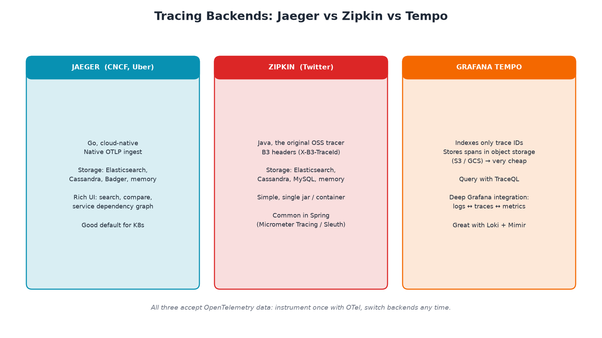

**Zipkin** (from Twitter, 2012) is the original open-source tracer, inspired by Google's Dapper paper. Simple to run, popular in the Java/Spring world, and uses **B3** headers.

```bash
docker run -d -p 9411:9411 openzipkin/zipkin
# UI: http://localhost:9411
```

**Grafana Tempo** is a high-scale tracing backend that **only indexes trace IDs** and stores spans in object storage, so it's very cheap. You find traces through **TraceQL**, exemplars from metrics, or trace IDs from logs.

```text
{ resource.service.name = "sample-app" && status = error && duration > 500ms }
```

| | Jaeger | Zipkin | Tempo |
|---|---|---|---|
| Origin | Uber → CNCF | Twitter | Grafana Labs |
| Storage | ES, Cassandra, Badger | ES, Cassandra, MySQL | S3/GCS/Azure (object storage) |
| Search | By service, operation, tags, duration | Similar | TraceQL |
| UI | Jaeger UI | Zipkin UI | Grafana |
| Best fit | General purpose, K8s | Simple Java/Spring setups | Grafana LGTM stack at scale |

> 💡 **Tip:** Try swapping the lab to Tempo: point the OTel Collector's exporter at Tempo instead of Jaeger and add a Tempo data source in Grafana. Your app code doesn't change. That's the power of OpenTelemetry.

---

## 33. OpenTelemetry (OTel)

**What it is:** A vendor-neutral, open-source **standard + toolkit** to generate, collect and export telemetry (traces, metrics, logs). It is the second most active CNCF project after Kubernetes, formed by merging OpenTracing and OpenCensus.

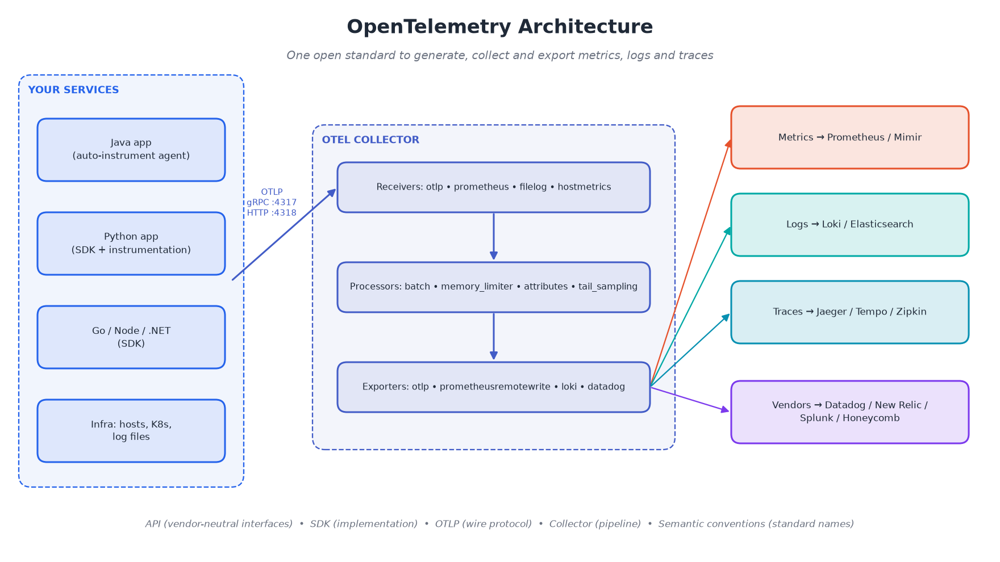

| Part | What it is |
|------|------------|
| **API** | Interfaces your code calls (`tracer.start_span`) |
| **SDK** | The implementation: sampling, processing, exporting |
| **Instrumentation libraries** | Auto-create spans for Flask, Spring, Express, gRPC, JDBC, Kafka… |
| **OTLP** | The OpenTelemetry Protocol (gRPC `:4317`, HTTP `:4318`) |
| **Collector** | A standalone pipeline: **receivers → processors → exporters** |
| **Semantic conventions** | Standard attribute names: `http.request.method`, `db.system`, `service.name` |

**Why DevOps people care:** **Instrument once, send anywhere.** Your code is not locked to Datadog, New Relic or Jaeger. Change one exporter in the Collector to switch vendors.

### 33.1 Auto vs manual instrumentation

```bash
# AUTO (zero-code): Java
java -javaagent:opentelemetry-javaagent.jar \
     -Dotel.service.name=checkout -Dotel.exporter.otlp.endpoint=http://otel-collector:4317 \
     -jar app.jar

# AUTO (zero-code): Python
pip install opentelemetry-distro opentelemetry-exporter-otlp
opentelemetry-bootstrap -a install
OTEL_SERVICE_NAME=checkout opentelemetry-instrument python app.py
```

```python
# MANUAL: add your own business spans
from opentelemetry import trace
tracer = trace.get_tracer("sample-app")

with tracer.start_as_current_span("payment.charge") as span:
    span.set_attribute("payment.method", "card")
    result = charge_card()
    if not result.ok:
        span.set_status(trace.Status(trace.StatusCode.ERROR, "card declined"))
```

### 33.2 The Collector config

```yaml
receivers:
  otlp:
    protocols:
      grpc: { endpoint: 0.0.0.0:4317 }
      http: { endpoint: 0.0.0.0:4318 }
processors:
  memory_limiter: { check_interval: 1s, limit_mib: 256 }
  batch: {}
exporters:
  otlp/jaeger:
    endpoint: jaeger:4317
    tls: { insecure: true }
service:
  pipelines:
    traces:
      receivers: [otlp]
      processors: [memory_limiter, batch]
      exporters: [otlp/jaeger]
```

Full file: [`examples/observability-stack/otel-collector/config.yaml`](examples/observability-stack/otel-collector/config.yaml).

**Deployment patterns:** **Agent** (DaemonSet/sidecar next to apps) → **Gateway** (central Collector deployment that does tail sampling and exports to backends).

### 33.3 Common environment variables

| Variable | Example |
|----------|---------|
| `OTEL_SERVICE_NAME` | `checkout-api` |
| `OTEL_EXPORTER_OTLP_ENDPOINT` | `http://otel-collector:4317` |
| `OTEL_RESOURCE_ATTRIBUTES` | `deployment.environment=prod,service.version=1.4.2` |
| `OTEL_TRACES_SAMPLER` / `OTEL_TRACES_SAMPLER_ARG` | `parentbased_traceidratio` / `0.1` |
| `OTEL_PROPAGATORS` | `tracecontext,baggage` |

---

## 34. Sampling

**What it is:** Keeping only a portion of traces, because storing 100% of traces at 50,000 requests/sec is very expensive.

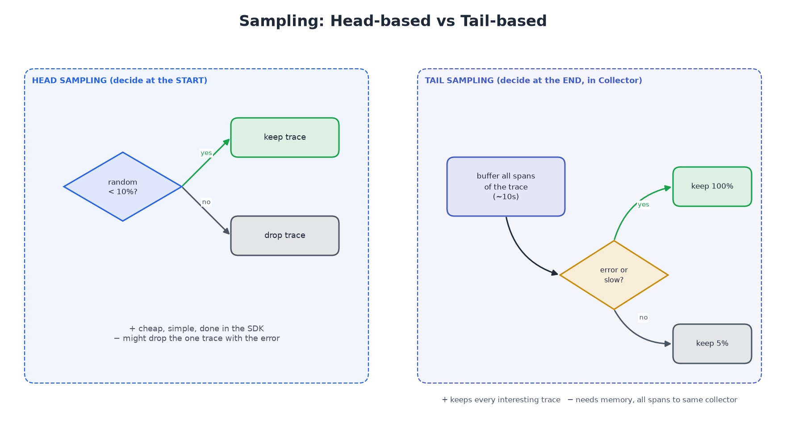

| | Head sampling | Tail sampling |
|---|---|---|
| Decision made | At the start of the trace (in the SDK) | After the trace finishes (in the Collector) |
| Can keep "all errors"? | ❌ No (it doesn't know yet) | ✅ Yes |
| Cost | Very low | Needs memory + all spans of a trace at one Collector |
| Config | `OTEL_TRACES_SAMPLER=parentbased_traceidratio`, `ARG=0.1` | `tail_sampling` processor in the Collector |

```yaml
# Collector: keep all errors, all slow traces, and 5% of the rest
processors:
  tail_sampling:
    decision_wait: 10s
    policies:
      - { name: errors, type: status_code, status_code: { status_codes: [ERROR] } }
      - { name: slow,   type: latency,     latency: { threshold_ms: 1000 } }
      - { name: rest,   type: probabilistic, probabilistic: { sampling_percentage: 5 } }
```

---

## 35. Correlating the Pillars

**What it is:** Linking metrics, logs and traces so you can jump between them during an incident. This is what turns three separate tools into **observability**.

| Link | How | In the lab |
|------|-----|-----------|
| **Logs → Traces** | Put `trace_id` in every log line | Loki derived field opens Jaeger ✅ |
| **Traces → Logs** | Search logs for the span's trace ID | Jaeger data source `tracesToLogsV2` ✅ |
| **Metrics → Traces** | **Exemplars**: a sample trace ID attached to a histogram bucket | Needs exemplar support in client + Prometheus |
| **Metrics → Logs** | Same labels (`service`, `env`, `namespace`) on both | Split view in Grafana Explore |
| **Traces → Metrics** | Generate RED metrics from spans (`spanmetrics` connector) | Optional OTel Collector add-on |

> 💡 **Tip:** Consistent **resource attributes** are the glue: use the same `service.name`, `deployment.environment` and `service.version` across metrics, logs and traces.


---

# PART 5: Practice

## 36. Hands-on Lab: Run the Full Stack

**What it is:** A complete observability platform on your laptop with Docker Compose: an instrumented Python app, a load generator, and the tools from this guide, all pre-wired.

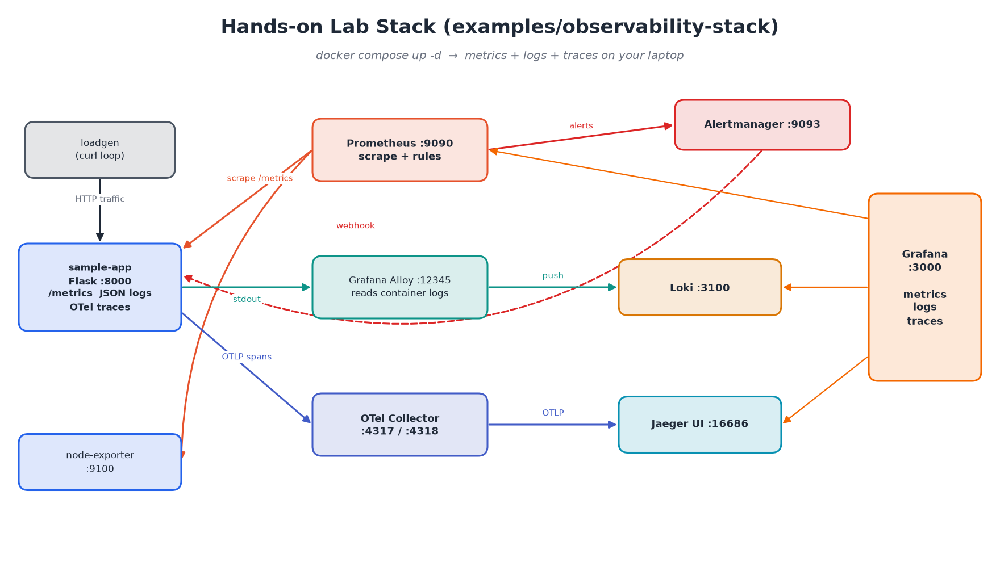

| Service | URL | Pillar |
|---------|-----|--------|
| sample-app | http://localhost:8000 | emits all 3 |
| Prometheus | http://localhost:9090 | metrics |
| Alertmanager | http://localhost:9093 | alerts |
| node-exporter | http://localhost:9100/metrics | metrics |
| Loki | http://localhost:3100 | logs |
| Grafana Alloy | http://localhost:12345 | logs (collector) |
| OTel Collector | :4317 / :4318 | traces (pipeline) |
| Jaeger | http://localhost:16686 | traces |
| **Grafana** | **http://localhost:3000** (admin / admin) | all 3 |

### 36.1 Prerequisites

- Docker Desktop (Windows/macOS) or Docker Engine + Compose plugin (Linux)
- ~4 GB free RAM
- Git

### 36.2 Start it

```bash
git clone https://github.com/KanishkaSemalPerera/Monitoring-Logging-and-Observability-DevOps.git
cd Monitoring-Logging-and-Observability-DevOps/examples/observability-stack

docker compose up -d --build
docker compose ps                    # all services should be "running"
```

Wait ~1 minute, then check:

```bash
curl localhost:8000/api/orders       # the app works
curl -s localhost:8000/metrics | grep http_requests_total
# browser: http://localhost:9090/targets  → all targets should be UP
```

### 36.3 Lab layout

```text
examples/observability-stack/
├── docker-compose.yml
├── sample-app/              # Flask app: /metrics, JSON logs, OTel traces
│   ├── app.py
│   ├── requirements.txt
│   └── Dockerfile
├── prometheus/
│   ├── prometheus.yml       # scrape config
│   └── rules/
│       ├── recording-rules.yml
│       └── alert-rules.yml
├── alertmanager/alertmanager.yml
├── alloy/config.alloy       # Docker logs → Loki
├── loki/loki-config.yml
├── otel-collector/config.yaml
└── grafana/
    ├── provisioning/        # data sources + dashboard provider
    └── dashboards/sample-app-red.json
```

### 36.4 Stop and clean up

```bash
docker compose down          # stop, keep data volumes
docker compose down -v       # stop and DELETE all data
```

> ⚠ **Warning:** These labs disable authentication and use default passwords to keep things simple. **Never** expose them to the internet or copy these settings to production.

---

## 37. Practice Labs

Do these in order. Each lab has a goal, steps, and a "done when" check.

### Lab 1: Explore raw metrics

1. Start the lab stack.
2. Open http://localhost:8000/metrics.
3. Find one **counter**, one **gauge** and one **histogram**.

✅ **Done when:** you can explain why `http_request_duration_seconds_bucket` has an `le` label.

### Lab 2: Your first PromQL

In Prometheus (http://localhost:9090) write queries for:

1. Is every target up?
2. Total requests per second for `sample-app`.
3. Requests per second **per route**.
4. Error percentage for `/api/orders`.
5. p95 latency for `/api/slow`.

<details>
<summary>Show answers</summary>

```promql
up
sum(rate(http_requests_total{job="sample-app"}[1m]))
sum by (route) (rate(http_requests_total{job="sample-app"}[1m]))
100 * sum(rate(http_requests_total{route="/api/orders",status=~"5.."}[5m]))
    / sum(rate(http_requests_total{route="/api/orders"}[5m]))
histogram_quantile(0.95, sum by (le) (rate(http_request_duration_seconds_bucket{route="/api/slow"}[5m])))
```

</details>

### Lab 3: Host monitoring with node_exporter

Write PromQL for CPU %, memory %, and disk used % of the Docker host (see the [PromQL cheat sheet](examples/queries/promql-cheatsheet.md)).

✅ **Done when:** you have all three as panels in a new Grafana dashboard.

### Lab 4: Watch an alert fire

1. Open http://localhost:9090/alerts. The app fails ~10% of orders on purpose, so `HighErrorRate` goes **Pending → Firing** after a few minutes.
2. Open Alertmanager http://localhost:9093 and see the grouped alert.
3. See the webhook arrive in the app logs:

```bash
docker logs sample-app 2>&1 | grep "ALERT RECEIVED"
```

✅ **Done when:** you can describe each state the alert went through.

### Lab 5: Silence an alert

Create a 30-minute silence for `HighErrorRate` in the Alertmanager UI (**New Silence**). Confirm no new webhook messages arrive. Then expire the silence.

### Lab 6: Write your own alert

Add an alert to `prometheus/rules/alert-rules.yml` that fires when **orders created per minute drops below 10**:

```yaml
- alert: LowOrderRate
  expr: sum(rate(orders_created_total[5m])) * 60 < 10
  for: 2m
  labels:
    severity: warning
  annotations:
    summary: "Orders per minute dropped below 10"
```

```bash
docker compose exec prometheus promtool check rules /etc/prometheus/rules/alert-rules.yml
curl -X POST localhost:9090/-/reload
docker compose stop loadgen          # make it fire!
```

✅ **Done when:** the alert fires after stopping `loadgen` and resolves after `docker compose start loadgen`.

### Lab 7: Build a dashboard from scratch

In Grafana, create a new dashboard with: a **stat** panel for RPS, a **time series** for error % by route, a **heatmap** of `http_request_duration_seconds_bucket`, and a `$route` variable. Export it as JSON (**Share → Export**).

### Lab 8: Search logs with LogQL

In Grafana → Explore → Loki:

1. Show all logs from `sample-app`.
2. Show only errors.
3. Count payment failures per payment method over 5m.
4. Show slow reports (`msg="slow report generated"`).

✅ **Done when:** query 3 shows a time series graph, not log lines.

### Lab 9: Follow one request through all three pillars

1. In Loki, find a `payment failed` log line.
2. Click its **TraceID** link → it opens in Jaeger.
3. Find the red `payment.charge` span and read its attributes.
4. From the trace, use **Logs for this span** to jump back to Loki.

✅ **Done when:** you can explain how the `trace_id` got into the log line (hint: look at `JsonFormatter` in `app.py`).

### Lab 10: Add a custom span

Add a new span `inventory.check` inside `/api/orders` in `app.py`, with an attribute `inventory.items`. Rebuild:

```bash
docker compose up -d --build sample-app
```

✅ **Done when:** the new span appears in Jaeger traces.

### Lab 11: EFK pipeline

1. Start `examples/efk-stack`.
2. In Kibana, create data views for `fluentbit-app-*` and `logstash-access-*`.
3. Find all `status >= 500` events in each.
4. Change `fluent-bit.conf` to drop `info` logs and confirm in Kibana.

### Lab 12: Break it and fix it (incident drill)

Ask a friend to do **one** of these without telling you which, then use the [troubleshooting flow](#38-debugging-workflow-using-all-three-pillars) to find it:

- `docker compose stop node-exporter`
- `docker compose stop otel-collector`
- Change the error probability in `app.py` from `0.10` to `0.5` and rebuild
- `docker compose stop alloy`

✅ **Done when:** you find the cause using only Grafana, Prometheus, Jaeger and Alertmanager (no peeking at `docker compose ps`!).

---

## 38. Debugging Workflow: Using All Three Pillars

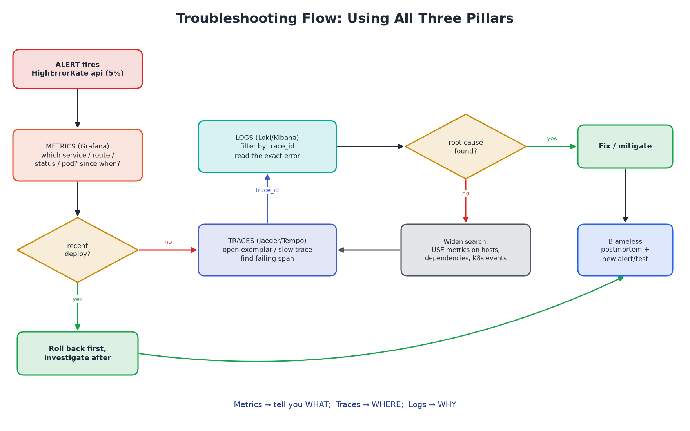

A repeatable incident process:

1. **Acknowledge** the alert so others know someone is on it.
2. **Assess impact**: which SLI is burning? How many users? (metrics)
3. **Recent change?** Check deploy annotations. If yes and impact is high: **roll back first**, investigate later.
4. **Narrow down**: which service, route, pod, region, version? (metrics with `by (...)`)
5. **Find where**: open a failing or slow trace. (traces)
6. **Find why**: read logs for that `trace_id`. (logs)
7. **Mitigate**: rollback, scale up, feature-flag off, failover.
8. **Communicate**: status page / incident channel updates.
9. **Postmortem**: blameless, with timeline, root cause, and action items (new alert, test, runbook).

> 💡 **Tip:** Track **MTTD** (time to detect) and **MTTR** (time to recover). Good observability shrinks both.

---

## 39. Best Practices and Anti-Patterns

| Area | ✅ Best practice | ❌ Anti-pattern |
|------|------------------|----------------|
| Metrics | RED for services, USE for resources | 5,000 metrics nobody looks at |
| Labels | Low-cardinality labels | `user_id`, `request_id`, full URL as labels |
| Alerts | Symptom-based, actionable, with runbooks | Alerting on every CPU spike |
| Alerts | SLO burn-rate alerts | Static thresholds everywhere |
| Dashboards | Few, focused, as code in Git | Hundreds of click-made, unowned dashboards |
| Logs | Structured JSON to stdout with `trace_id` | Multi-line plain text in files |
| Logs | Retention policies + drop noise | Keeping every debug line forever |
| Security | Mask secrets/PII; restrict access to logs | Tokens and passwords in logs |
| Traces | OpenTelemetry + propagation everywhere | Vendor-specific SDKs in every service |
| Traces | Tail sampling for errors/slow requests | 100% sampling at high traffic |
| Tooling | Monitor your monitoring (meta-monitoring) | Prometheus is down and nobody knows |
| Culture | On-call rotation, blameless postmortems | Hero culture, blame |

> 💡 **Tip:** "Who watches the watchers?" Always add a **dead man's switch**: an alert that is **always firing** (`expr: vector(1)`) and is sent to an external service. If it **stops** arriving, your alerting pipeline is broken.

---

## 40. Cheat Sheet

### 40.1 Ports

| Tool | Port |
|------|------|
| Prometheus | 9090 |
| Alertmanager | 9093 |
| Pushgateway | 9091 |
| node_exporter | 9100 |
| blackbox_exporter | 9115 |
| Grafana | 3000 |
| Loki | 3100 |
| Grafana Alloy UI | 12345 |
| Elasticsearch | 9200 (HTTP), 9300 (transport) |
| Kibana | 5601 |
| Logstash | 5044 (Beats), 9600 (API) |
| Fluent Bit | 2020 (HTTP metrics), 24224 (forward) |
| Jaeger UI | 16686 |
| Zipkin | 9411 |
| Tempo | 3200 |
| OTLP | 4317 (gRPC), 4318 (HTTP) |
| Splunk | 8000 (web), 8089 (mgmt), 9997 (forwarders), 8088 (HEC) |
| Zabbix | 10050 (agent), 10051 (server) |
| Nagios NRPE | 5666 |

### 40.2 Query languages

| Tool | Language | Example |
|------|----------|---------|
| Prometheus | PromQL | `sum(rate(http_requests_total[5m]))` |
| Loki | LogQL | `{app="api"} \|= "error"` |
| Kibana | KQL | `level : "error" and status >= 500` |
| Splunk | SPL | `index=web status>=500 \| stats count by host` |
| Tempo | TraceQL | `{ status = error && duration > 1s }` |
| New Relic | NRQL | `SELECT count(*) FROM Transaction FACET appName` |

### 40.3 Commands

```bash
# Prometheus
promtool check config prometheus.yml
promtool check rules rules/*.yml
curl -X POST localhost:9090/-/reload
curl 'localhost:9090/api/v1/query?query=up'

# Alertmanager
amtool check-config alertmanager.yml
amtool --alertmanager.url=http://localhost:9093 alert query
amtool --alertmanager.url=http://localhost:9093 silence add alertname=X --duration=1h --comment="maint"

# Elasticsearch
curl localhost:9200/_cluster/health?pretty
curl localhost:9200/_cat/indices?v
curl localhost:9200/_cat/shards?v

# Loki (logcli)
logcli query '{service_name="sample-app"} |= "error"' --since=1h

# Kubernetes quick checks
kubectl top pods -A
kubectl get events -A --sort-by=.lastTimestamp
kubectl logs -f deploy/my-app --since=10m
```

More cheat sheets in [`examples/queries/`](examples/queries/).

---

## 41. Interview Questions

<details>
<summary><b>1. What are the three pillars of observability?</b></summary>

Metrics (numeric time series, for alerts and trends: *what*), logs (detailed event records: *why*), and traces (a request's path across services: *where*). Their real value comes from correlating them with shared labels and trace IDs.
</details>

<details>
<summary><b>2. Monitoring vs observability?</b></summary>

Monitoring watches known failure modes with predefined dashboards and thresholds. Observability is the ability to understand any internal state from external outputs, including unknown problems, using rich, correlated telemetry.
</details>

<details>
<summary><b>3. Explain Prometheus architecture.</b></summary>

The Prometheus server discovers targets (static or service discovery), scrapes `/metrics` over HTTP (pull model), stores samples in its local TSDB, evaluates recording and alerting rules, and serves PromQL queries. Alerts go to Alertmanager. Exporters expose metrics for third-party systems; Pushgateway handles short-lived jobs. Grafana visualizes the data.
</details>

<details>
<summary><b>4. What are the four Prometheus metric types?</b></summary>

Counter (only increases; use `rate`), gauge (up/down), histogram (bucketed counts + sum + count; aggregatable; `histogram_quantile`), summary (client-side quantiles; not aggregatable across instances).
</details>

<details>
<summary><b>5. Difference between rate() and irate()?</b></summary>

`rate()` gives the average per-second increase over the whole range, which is smooth and good for alerts. `irate()` uses only the last two samples, so it is very responsive but spiky; use it for fast-moving graphs.
</details>

<details>
<summary><b>6. What is high cardinality and why is it a problem?</b></summary>

Cardinality is the number of unique label combinations. Each one is a separate time series (or log stream in Loki). Labels like `user_id` or `request_id` create millions of series, blowing up memory, storage and query time. Keep such values in logs/traces, not metric labels.
</details>

<details>
<summary><b>7. How does Alertmanager reduce alert noise?</b></summary>

Deduplication (same alert from HA Prometheus pairs), grouping (`group_by` combines related alerts into one notification), inhibition (a critical alert mutes related warnings), silences (temporary mutes), and routing to the right team with timing controls (`group_wait`, `group_interval`, `repeat_interval`).
</details>

<details>
<summary><b>8. What is the `for` clause in an alert rule?</b></summary>

How long the expression must be continuously true before the alert moves from Pending to Firing. It prevents flapping alerts from brief spikes.
</details>

<details>
<summary><b>9. Explain RED and USE.</b></summary>

RED (Rate, Errors, Duration) is for request-driven services. USE (Utilization, Saturation, Errors) is for resources like CPU, memory, disk and network. Google's four golden signals are latency, traffic, errors and saturation.
</details>

<details>
<summary><b>10. What is an SLO and an error budget?</b></summary>

An SLO is a target for a service level indicator, e.g. 99.9% of requests succeed over 30 days. The error budget is 100% − SLO (0.1% ≈ 43 minutes/month). When the budget is healthy, teams ship faster; when it's exhausted, they focus on reliability.
</details>

<details>
<summary><b>11. ELK vs EFK?</b></summary>

Both use Elasticsearch for storage/search and Kibana for UI. ELK uses Logstash (JVM, powerful parsing, heavier) usually with Beats. EFK uses Fluentd/Fluent Bit (lightweight, CNCF, typical as a Kubernetes DaemonSet).
</details>

<details>
<summary><b>12. Fluentd vs Fluent Bit?</b></summary>

Fluent Bit is written in C, uses very little memory, and is ideal as a node-level collector. Fluentd is Ruby-based with a huge plugin ecosystem, better suited as a central aggregator. A common pattern is Fluent Bit → Fluentd → backend.
</details>

<details>
<summary><b>13. How is Loki different from Elasticsearch?</b></summary>

Loki indexes only labels and stores compressed chunks in object storage, so it is much cheaper and simpler, but full-text searches over large ranges are slower. Elasticsearch indexes all content for fast full-text search and analytics at higher cost and operational effort.
</details>

<details>
<summary><b>14. What are Elasticsearch shards and replicas? What do yellow and red health mean?</b></summary>

An index is split into primary shards for scale; each primary can have replicas on other nodes for HA and read throughput. Yellow = all primaries assigned, some replicas not. Red = at least one primary is unassigned, so some data is unavailable.
</details>

<details>
<summary><b>15. What is a trace and a span?</b></summary>

A trace is the end-to-end record of one request, identified by a trace ID. It is a tree of spans; each span represents one operation with a name, start time, duration, attributes, status and parent span ID.
</details>

<details>
<summary><b>16. How does context propagation work?</b></summary>

The caller injects the trace context into outgoing requests (W3C `traceparent` header: version, trace ID, parent span ID, flags). The callee extracts it and creates child spans with the same trace ID. OTel instrumentation does this automatically for common HTTP, gRPC and messaging libraries.
</details>

<details>
<summary><b>17. What is OpenTelemetry and why use it?</b></summary>

A CNCF vendor-neutral standard with APIs, SDKs, auto-instrumentation, the OTLP protocol and the Collector for traces, metrics and logs. It avoids vendor lock-in: instrument once, then export to Jaeger, Tempo, Prometheus, Datadog, New Relic, etc. by changing configuration.
</details>

<details>
<summary><b>18. What does the OpenTelemetry Collector do?</b></summary>

It receives telemetry (receivers: OTLP, Prometheus, filelog…), processes it (batching, memory limiting, attribute changes, filtering, tail sampling), and exports it to one or more backends. It's deployed as an agent (per node/sidecar) and/or a gateway.
</details>

<details>
<summary><b>19. Head-based vs tail-based sampling?</b></summary>

Head sampling decides at trace start (cheap, but may drop interesting traces). Tail sampling decides after the trace completes, in the Collector, so it can keep all errors and slow traces, but needs buffering and routing all spans of a trace to the same Collector.
</details>

<details>
<summary><b>20. Jaeger vs Zipkin vs Tempo?</b></summary>

Jaeger: CNCF, rich UI, multiple storage backends, native OTLP. Zipkin: the original OSS tracer, simple, B3 headers, popular with Spring. Tempo: indexes only trace IDs and uses object storage, very cheap at scale, queried with TraceQL in Grafana.
</details>

<details>
<summary><b>21. Prometheus vs Datadog vs Zabbix vs Nagios?</b></summary>

Prometheus: OSS, pull, cloud-native, PromQL, self-managed. Datadog: SaaS all-in-one with agents and many integrations; convenient but costly at scale. Zabbix: OSS enterprise infra/network monitoring with agents, SNMP and templates. Nagios: classic plugin-based up/down checks with limited metrics capability.
</details>

<details>
<summary><b>22. How would you monitor a Kubernetes cluster?</b></summary>

Install kube-prometheus-stack (Prometheus Operator, Alertmanager, Grafana, node-exporter, kube-state-metrics); scrape apps with ServiceMonitors; collect logs with Fluent Bit or Alloy into Loki/Elasticsearch; trace with OpenTelemetry + Jaeger/Tempo; alert on SLOs, pod crash loops, node pressure, and PVC usage; store long-term metrics with Thanos/Mimir.
</details>

<details>
<summary><b>23. How do you scale Prometheus or keep metrics long-term?</b></summary>

Shard scraping across multiple Prometheus servers, use recording rules, reduce cardinality, run HA pairs, and add Thanos, Mimir/Cortex or VictoriaMetrics via `remote_write` or sidecars for long-term storage, global querying and deduplication.
</details>

<details>
<summary><b>24. What is alert fatigue and how do you prevent it?</b></summary>

When on-call gets too many low-value alerts and starts ignoring them. Prevent it with symptom-based, actionable alerts with runbooks, SLO burn-rate alerts, `for` durations, grouping/inhibition, correct severities, and regular alert reviews to delete noisy ones.
</details>

<details>
<summary><b>25. Walk me through debugging a latency spike.</b></summary>

Confirm and scope it with metrics (which service/route/region/version, when it started, any deploy). Check saturation (CPU, memory, connection pools, queues). Open slow traces (or exemplars) to find the slow span. Read logs for those trace IDs. Mitigate (rollback/scale/feature-flag), then write a blameless postmortem with follow-up actions.
</details>

---

## 42. Reference

### Official docs

| Tool | Docs |
|------|------|
| Prometheus | https://prometheus.io/docs/ |
| Alertmanager | https://prometheus.io/docs/alerting/latest/alertmanager/ |
| Grafana | https://grafana.com/docs/grafana/latest/ |
| Grafana Loki | https://grafana.com/docs/loki/latest/ |
| Grafana Alloy | https://grafana.com/docs/alloy/latest/ |
| Grafana Tempo | https://grafana.com/docs/tempo/latest/ |
| Elasticsearch / Kibana / Logstash | https://www.elastic.co/guide/index.html |
| Fluent Bit | https://docs.fluentbit.io/ |
| Fluentd | https://docs.fluentd.org/ |
| Splunk | https://docs.splunk.com/ |
| Jaeger | https://www.jaegertracing.io/docs/ |
| Zipkin | https://zipkin.io/ |
| OpenTelemetry | https://opentelemetry.io/docs/ |
| Datadog | https://docs.datadoghq.com/ |
| New Relic | https://docs.newrelic.com/ |
| Zabbix | https://www.zabbix.com/documentation/current/ |
| Nagios | https://www.nagios.org/documentation/ |

### Further reading

- *Site Reliability Engineering* (Google SRE book), chapter "Monitoring Distributed Systems": https://sre.google/sre-book/monitoring-distributed-systems/
- *The Site Reliability Workbook*, "Alerting on SLOs": https://sre.google/workbook/alerting-on-slos/
- Brendan Gregg, *The USE Method*: https://www.brendangregg.com/usemethod.html
- W3C Trace Context: https://www.w3.org/TR/trace-context/
- Awesome Prometheus alerts (ready-made rules): https://samber.github.io/awesome-prometheus-alerts/

### 📁 What's in this repo

```text
.
├── README.md                          # this lesson
├── images/                            # all diagrams (PNG)
└── examples/
    ├── observability-stack/           # full lab: Prometheus, Alertmanager, Grafana,
    │                                  # Loki, Alloy, OTel Collector, Jaeger + sample app
    ├── efk-stack/                     # Elasticsearch, Kibana, Fluent Bit, Logstash lab
    ├── kubernetes/                    # ServiceMonitor, PrometheusRule, Fluent Bit DaemonSet
    └── queries/                       # PromQL, LogQL, KQL, SPL, TraceQL cheat sheets
```

---

⭐ If this guide helped you, **star the repo** and share it with another DevOps learner. Found a mistake or want to add a topic? Open an issue or a pull request.
